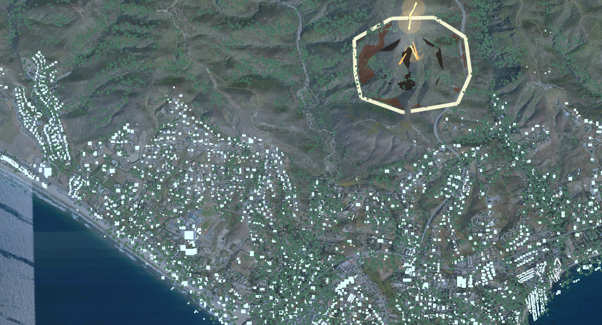

# FlytBase Sentinel · Autonomous Aerial Intelligence



## Overview

**FlytBase Sentinel** is a prototype of an AI-native emergency-response command interface: an autonomous-drone intelligence platform built for a product design portfolio.

The core premise is **Human-in-the-Loop AI Collaboration**. Sentinel (driven by an AI copilot called **TALON**) assembles evidence, reasons, recommends, and stages plans during a wildfire initial-attack scenario. The operator's role is not to path-find drones but to **authorize, override, and execute** high-level AI-generated strategy. TALON never sends, deploys, or executes — the human authorizes every consequential action.

The product runs on a **two-phase workflow model**:

- **Intelligence** — Detect · Verify · Escalate (inform the first defensible escalation decision)
- **Operations** — Stage · Coordinate · Supervise (post-notification tactical coordination)

A scenario spans **20 states** — the guided 90-second arc, the human/AI **disagreement** arc (contested watch, re-raise), the operations arc, and four injected fault scenes, every one with a real recovery exit.

## Key Prototype Features

- 🚁 **Guided escalation arc** — from anomaly scan to a gated authority packet, under 90 seconds.
- 🎨 **Adaptive density** — the interface sheds peripheral data as urgency rises, keeping one dominant decision in view.
- 🥊 **Human/AI disagreement with memory** — the operator can overrule TALON; the dissent is recorded verbatim, the rejected hypothesis stays watched at reduced weight, and TALON may re-raise only once *new* evidence crosses the bar.
- 🎙️ **Operator overrides** — conversational corrections to recommended plans ("TALON recomputes rather than argues").
- 📉 **Degraded / fault modes** — signal loss, network degradation, battery-critical handoff, and total infrastructure loss, each with a verified recovery path.
- 🔒 **Human gates + receipts** — high-consequence actions require explicit authorization and leave a plain-language audit receipt.

## Tech Stack

A local, scripted graphical simulation of the front-end experience — no live drone feeds or production AI.

- **Framework:** React 18 + Vite (TypeScript)
- **Design system:** `src/app/tokens.ts` (single source of truth) — consumed as inline styles / CSS with a strict token contract
- **Components:** custom product surfaces + `motion` for animation; `src/app/components/ui/` is an archived, unused shadcn tree
- **Map:** 2D SVG spatial canvas + a 3D explore mode (three.js)
- **Data:** deterministic in-repo fixtures across the 20 scenes

## Running Locally

```bash
npm install
npm run dev                 # dev server → http://localhost:5173/embed/sentinel/
npm run build && npm run preview -- --port 4190   # production preview
```

Open the app and use the **SCENES** chip (or `?scene=<id>` deep links) to walk the flows. Add `?core=1` for the portfolio embed view (hides the review dock). `?layout=legacy` falls back to the pre-promotion shell; the default is shell v2.

## Verification

The repo ships its own gates — keep them green:

```bash
npm run verify:design   # typecheck + token audit + map checks
npm run verify:flows    # 19 browser flows
npm run verify:routes   # 23 scene/view combos (a11y + console)
npm run verify:machine  # state-machine integrity
npm run verify:signals  # telemetry integrity
```

`verify:flows` / `verify:routes` need the preview server running (see `AGENTS.md` for the URL note).

## Plan & Case Study

- **Final build plan:** [`docs/sentinel-v2-master-plan/`](docs/sentinel-v2-master-plan/) — `00` (thesis) through `09` (TALON mark spec), with `08` as the phase roadmap.
- **The journey:** every earlier planning generation, rejected concept, and case-study draft lives in [`docs/archive/`](docs/archive/) — the failure/decision/iteration record for the case study.
- The published case-study link is maintained in the portfolio site (see `PORTFOLIO-DIRECTION.md`).

> Working on this repo with an AI tool? **Read [`AGENTS.md`](AGENTS.md) first** — it defines the authority order, the golden rules, and the gates.

---

*Designed and developed as a showcase piece by Rudra.*
