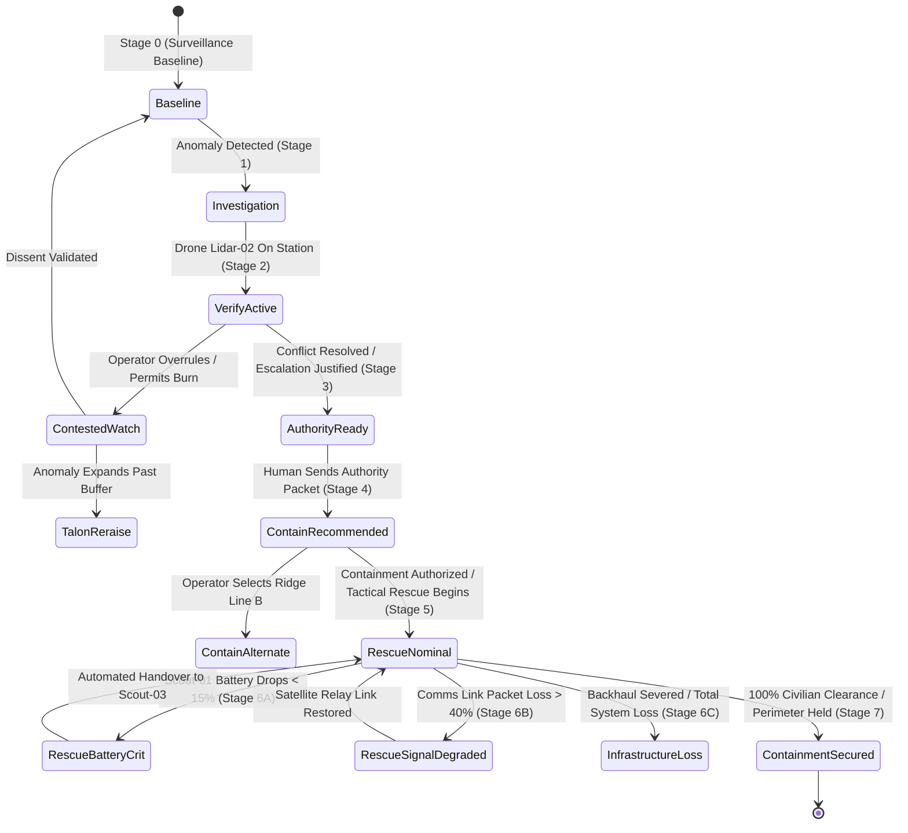

# FlytBase Sentinel V2: Master System, Route Topology & Multi-Scenario Data Specification

> **Status:** historical — superseded by docs/sentinel-flagship-quality-upgrade.md (canonical build authority). Known-false claims: see README.md in this folder.

> **Document Status**: Historical (quarantined) — see the status header above and the folder README.
> **Target Audience**: AI Product Design Directors, Enterprise Autonomous Systems Engineers, Senior AI System Evaluators  
> **Scope**: End-to-End Operational Lifecycle, Real-World WUI Data Grounding, Multi-Scenario Mock Databases, LLM Agentic Backend Integration, and UI Surface Telemetry Mapping.

---

## 1. Executive Vision & Strategic Product Positioning

FlytBase Sentinel is an enterprise-grade **Autonomous Spatial Operating System (Spatial OS)** for emergency wildfire response and Wildland-Urban Interface (WUI) perimeter defense.

### 1.1 The Dual-Competency Demonstration
This prototype is engineered to demonstrate two rare, intersecting senior capabilities:
1. **Top-Tier AI Product Design**:
   - Human-in-the-Loop (HITL) safety governance and multi-tier authorization gates.
   - Cognitive load calibration: transitioning seamlessly from **Predictive Analytics (Intelligence)** to **Tactical Orchestration (Operations)**.
   - Clear distinction between AI synthesis (autonomous) and high-consequence operational execution (human-gated).
   - Explicit uncertainty modeling: exposing conflicting evidence, sensor latency, and dissenting operator overrides.
2. **Full-Stack AI Systems Engineering**:
   - A real AI backend (Gemini / Claude / OpenAI API) with structured tool/function calling that directly manipulates the spatial state machine.
   - A deterministic multi-scenario database engine simulating authentic wildfire propagation, telemetry dropouts, and resource constraints.
   - High-performance WebGL 3D rendering (batched instancing, on-demand render loops, zero-idle GPU draw).

### 1.2 The Core Operational Thesis
> **We do not use AI to automate emergency judgment. We use AI to compress the time required to reach a defensible first judgment from 15 minutes to under 90 seconds, followed by supervisory overwatch.**

In an emergency initial attack, automated systems that pretend to "solve" a fire autonomously are dangerous science fiction. Sentinel splits the lifecycle:
- **Phase 1: Intelligence Convergence (0–90 Seconds)**: Accelerating sensor triangulation, drone verification, and evidence synthesis to deliver a hash-chained, auditable **mutual-aid notification draft** (TALON prepares; the operator sends).
- **Phase 2: Tactical Operations (Post-90s Execution)**: Dynamic multi-agent coordination, corridor defense, evacuation route clearing, and exception handling under continuous human oversight.

```
┌────────────────────────────────────────────────────────────────────────────────────────────────┐
│                                SENTINEL OPERATIONAL LIFECYCLE                                  │
├────────────────────────────────────────┬───────────────────────────────────────────────────────┤
│    PHASE 1: INTELLIGENCE CONVERGENCE   │             PHASE 2: TACTICAL OPERATIONS              │
│            (0 to 90 Seconds)           │               (Post-90s Execution)                    │
├────────────────────────────────────────┼───────────────────────────────────────────────────────┤
│ • Baseline Surveillance Patrol         │ • Staging: Containment Plan A / B / C Selection       │
│ • Thermal Anomaly Triangulation        │ • Dispatch: Ground Team Corridor Ingress (Route A/B)  │
│ • Tactical Drone Scout Dispatch        │ • Evacuation: Civilian Structure Clearance Tracking   │
│ • Multi-Source Conflict Resolution     │ • Dynamic Reroute: Wind Shifts & Flare-ups            │
│ • Mutual-Aid Notification Draft        │ • Exception Handling: Signal/Battery/Sensor Degradation│
│ • HARD HUMAN GATE: Incident Escalation │ • Closeout: Blackline Containment & Forensic Audit    │
└────────────────────────────────────────┴───────────────────────────────────────────────────────┘
```

---

## 2. Real-World Wildfire Grounding & Incident Data Science

To be credible to real-world fire chiefs, defense operators, and enterprise evaluators, Sentinel is grounded in established standards: **NWCG (National Wildfire Coordinating Group)**, **USFA/FEMA NIMS (National Incident Management System)**, **ICS (Incident Command System)**, and **CAL FIRE initial attack doctrine**.

### 2.1 What Real Wildfire Operations Actually Measure
A genuine initial-attack sizeup requires specific, standardized telemetry:

| Data Domain | Real-World Standard / Parameter | How Sentinel V2 Models It |
|---|---|---|
| **Incident Size-up** | NWCG PMS 461 / ICS-201 (Incident Briefing) | Point of origin, estimated acreage, fuel model, rate of spread (ROS), potential for escape. |
| **Fire Behavior** | Rothermel Surface Spread Model, Albini Wind Vectors | Dynamic ellipse expansion, flame length (FL), head/flank/backing fire intensity. |
| **Vegetation & Fuel** | Scott & Burgan 40 Fire Behavior Fuel Models (FBFM40) | Fuel Model 4 (Chaparral / High Brush), 1-hr (fine) fuel moisture (4%), 10-hr (stick) moisture (6%), 100-hr dead fuel moisture (8%). |
| **Meteorology** | RAWS (Remote Automated Weather Stations), 20ft Wind | Direction (NE 38°), sustained speed (14 kts), gusts (24 kts), Relative Humidity (RH: 14%), Haines Index (5 - High). |
| **Spaceborne Sensing** | NOAA GOES-R ABI (3.9µm shortwave IR) vs NASA VIIRS 375m | Geostationary rapid-ping (5 min, low-res) corroborated against polar-orbiting VIIRS I-band (375m, high-res but 4hr stale). |
| **Aerial Remote Sensing** | FLIR LWIR/MWIR (Radiometric), LiDAR canopy penetration | Uncooled thermal radiometric sensor (calibrated 60°F–1200°F), LiDAR surface fuel height, visual HD optical stream at 24 fps. |
| **Values at Risk (VAR)** | NFPA 1144/1140 WUI Structure Triage, GIS Parcel Data | Structure count (47 residential parcels in Grid 4C), occupancy status, defensible space rating, evacuation viability. |
| **Incident Command** | ICS-204 (Assignment List), ICS-209 (Status Summary) | Tactical team rosters (Engine 9, Command Unit 4, Strike Team Alpha), operational period, comms channels (TAC-3, AIR-TO-GROUND). |
| **Civilian Egress** | CAD (Computer Aided Dispatch) 911 geocodes, Road Networks | Chokepoints (East Ridge Rd single-lane egress), corridor status (Route A clear / Route B standby), evacuation clearance counter. |

### 2.2 Gap Analysis: Legacy Prototype vs. Master V2 System
```
LEGACY MOCKUP:
  - "Fire confidence: 78%" (Black-box single number; no source attribution)
  - Generic buttons: "Deploy Drones", "Start Rescue"
  - 90-second timer claiming full incident resolution
  - No conflict handling (all sensors magically agreed)

MASTER V2 SYSTEM:
  - Multi-source convergence matrix (Thermal vs Satellite vs LiDAR vs Wind)
  - Explicit uncertainty: "Satellite IR reports permitted burn; Drone FLIR detects uncontrolled active run"
  - 90-second boundary applies strictly to Authority Escalation Notification
  - Realistic ICS ground assignments, fuel moisture indices, and NFPA structure triage
```

---

## 3. Complete Lifecycle Stages & Route Topology

Sentinel implements an 8-stage state machine covering 23 distinct system routes, including happy paths, operator dissents, tactical reraises, and catastrophic hardware failovers.



### 3.1 Stage Breakdown & Route Inventory

#### Stage 0: Surveillance Baseline / Quiet Watch
* **Route**: `/scene-baseline`
* **Operational Mode**: `monitoring` | **Workflow Phase**: `intelligence`
* **Status**: Nominal patrol. No active emergency.
* **Map Display**: Ambient 3D terrain, automated drone patrol vectors (Scout-01, Scout-02, Relay-01), 3 active evidence sources.
* **Panels**: Left rail shows System Health (All nominal) + Source Freshness. Right rail shows TALON Decision Brief ("No active incident. Quiet watch maintained").
* **Command Bar**: Clean single-pill posture: `TALON holding · nothing staged`.

#### Stage 1: Anomaly Triangulation & Size-Up
* **Route**: `/scene-investigation-pending`
* **Operational Mode**: `investigation` | **Workflow Phase**: `intelligence`
* **Trigger**: Thermal sensor cluster registers 480°F spike in Grid 4C. Satellite IR detects thermal bloom.
* **Map Display**: Pulsing amber anomaly ring at coordinate `37.8821°N, 122.4194°W`. Projected 15-minute spread cone.
* **TALON Action**: Flags potential wildland ignition. Initiates automated dispatch of scout asset.
* **HITL Policy**: Dispatch of drone for visual confirmation is autonomous (pre-authorized standard patrol SOP).

#### Stage 2: Tactical Verification & Source Convergence
* **Routes**: `/scene-verify-active`, `/core-verify-active`
* **Operational Mode**: `verification` | **Workflow Phase**: `intelligence`
* **Event**: Drone `Lidar-02` arrives on station. Live dual-stream (FLIR thermal + visual 4K) activates.
* **Source Conflict Engine**:
  - Drone FLIR reads **840°F crown fire spread** moving at 12 meters/min.
  - State Agricultural Board database flags a **permitted stubble burn** 400m north.
  - TALON halts autonomous escalation: *`SOURCE CONFLICT: Thermal anomaly reads as uncontrolled fire; Satellite IR cross-references agricultural burn permit. Awaiting operator resolution.`*
* **Command Bar**:
  - Left Pill: `[ Decline escalation · Records dissent ]`
  - Center: TALON Orb pulsing amber.
  - Right Pill (Gated): `[ Prepare authority packet · Blocked by source conflict ]` (Single line with tooltip).

#### Stage 3: Human Authority Gate & Escalation Dispatch
* **Routes**: `/scene-authority-notification-ready`, `/core-authority`
* **Operational Mode**: `escalation` | **Workflow Phase**: `intelligence` (Final 15 seconds of the 90s countdown)
* **Event**: Operator checks box: *"Confirm agricultural burn permit checked & invalid (burn exceeds permit perimeter)"*.
* **TALON Action**: Instantly compiles the **mutual-aid notification draft AUD-90-0847** with a hash-chained receipt.
* **HITL Policy (Class 3 Hard Gate)**: The notification to Regional Fire Dispatch (CAL FIRE Northern Command) is a mutual-aid notification draft — TALON prepares it and never sends; the operator does. No legal-instrument authority is claimed. Requires **2-second continuous hold** on the command plinth.

#### Stage 4: Containment Staging & Plan Pitch
* **Routes**: `/scene-contain-recommended`, `/scene-contain-alternate`, `/scene-contain-degraded`
* **Operational Mode**: `containment` | **Workflow Phase**: `operations`
* **Cognitive Shift**: The UI shifts from evidence analysis to tactical resource orchestration.
* **Plan Options**:
  - **Plan A (Recommended - Ridge Anchor)**: Primary retardant drop along West Ridge road + Drone Relay-02 aerial acoustic guidance. Protects 47 homes. Resource cost: 4 drones, 2 ground engines.
  - **Plan B (Alternate - Creek Buffer)**: Sacrifices eastern brush to establish defense at Bear Creek. Lower crew risk, higher structure exposure (12 homes in hazard zone).
  - **Plan C (Degraded - Resource Deficit)**: Used if Engine 9 is unavailable. Relies solely on autonomous drone acoustic evacuation guidance.
* **Command Bar**: `[ HOLD 2s TO AUTHORIZE CONTAINMENT PLAN ]` (Amber/Teal plinth).

#### Stage 5: Tactical Rescue & Civilian Evacuation
* **Routes**: `/scene-rescue-nominal`
* **Operational Mode**: `operations` | **Workflow Phase**: `operations`
* **Event**: Containment plan authorized. Incident Commander assumes tactical control with TALON supervisory overwatch.
* **Map Display**: Active evacuation corridors (Route A active in green/cyan, Route B standby in dashed amber). Ground team telemetry dots (Engine 9, Alpha Team). 3D building parcel occupancy pins.
* **Panels**:
  - Left Rail: Active Drone Fleet (Battery, link quality, assigned task).
  - Right Rail: Structure Clearance Counter (`26/47 cleared`), Ground Team Vitals (`HR 118, VIS 120m`).
* **Command Bar**: Transitions to supervisory status: `✓ Execution autonomous · Exceptions staged in right rail`.

#### Stage 6: Edge Cases, Degraded States & Catastrophic Failsafes

##### 6A: Operator Dissent / False Positive Overrule
* **Routes**: `/scene-monitoring-contested`, `/core-contested`
* **Trigger**: Operator overrides TALON at Stage 2, declaring the fire is indeed a controlled burn.
* **State Behavior**: System enters **Contested Watch**. The dissent is immutably logged to the audit ledger:
  > *`03:49:02 UTC — DISSENT LOGGED: Operator A. Rao overruled TALON escalation. Reason: Permitted burn verified via local radio. TALON tracking in contested watch mode.`*
* **Safety Net**: If thermal signature expands by >15% over 60 seconds, TALON triggers **Scene-Talon-Reraise** (`/scene-talon-reraise`), forcing an immediate audible re-evaluation.

##### 6B: Unexpected Wind Vector Shift
* **Route**: `/scene-talon-reraise`
* **Trigger**: Wind shifts 180° (NE 38° → SW 210°, gusts to 32 kts).
* **State Behavior**: Fire flanks jump the West Ridge retardant line. Route A evacuation corridor is directly compromised by heavy smoke and spot fires.
* **TALON Action**: Automatically promotes Route B (Valley Ingress) to primary evacuation corridor. Sends priority audio alert: *`"Warning: Route A compromised by wind shift. Rerouting ground teams to Route B."`*

##### 6C: Aerial Asset Battery Critical
* **Route**: `/scene-rescue-battery-critical`
* **Trigger**: Drone `Scout-01` battery drops below 15% while guiding civilian evacuation on Route A.
* **State Behavior**: TALON stages autonomous **Asset Relay Handover**:
  - `Scout-03` is pre-dispatched from Nest 2 to intercept `Scout-01`'s waypoint.
  - Zero gap in acoustic/visual evacuation guidance.
  - `Scout-01` returns to pad with 8% reserve.

##### 6D: Telemetry Link Degradation
* **Route**: `/scene-rescue-signal-degraded`
* **Trigger**: Dense pyrocumulus smoke cloud attenuates RF signal to Strike Team Alpha (packet loss 48%, latency 420ms).
* **State Behavior**: Right rail displays amber advisory exception. Map displays estimated dead-reckoning cone for ground teams. Tactical actions are locked until Mesh Drone `Relay-03` is repositioned overhead.

##### 6E: Satellite Feed Loss (Loss of Corroboration)
* **Route**: `/scene-satellite-feed-loss`
* **Trigger**: Geostationary satellite downlink times out during initial sizeup.
* **State Behavior**: TALON refuses to generate high-confidence escalation packet without secondary corroboration. Prompts operator: *`"Satellite feed offline. Dispatching second aerial drone Scout-03 for optical cross-corroboration."`*

##### 6F: Total Infrastructure Collapse / Black Sky
* **Route**: `/scene-infrastructure-total-loss`
* **Trigger**: Loss of both satellite backhaul and regional base station power.
* **State Behavior**: Full-screen **Red Takeover Surface**.
  - All AI automated controls disengage.
  - UI displays high-contrast fallback directory: Regional Fire Dispatch landline (`1-800-555-FIRE`), Tactical VHF Radio Frequency (`154.280 MHz - VFIRE21`), and last-known ground team GPS coordinates.
  - Shows the evaluator: *Sentinel knows when to gracefully step out of the way.*

---

## 4. Multi-Scenario Mock Database Architecture

To ensure external evaluators (recruiters, VP of Design, Engineering Directors) do not experience a canned, one-trick demo, the prototype is underpinned by a **Relational Multi-Scenario Mock Database Engine**.

```
┌────────────────────────────────────────────────────────────────────────┐
│                     MULTI-SCENARIO DATABASE ENGINE                     │
├────────────────────────────────────────────────────────────────────────┤
│  [ Scenario Selector: A | B | C | D ]                                  │
│           │                                                            │
│           ├──> Scenario A: Bear Creek Wildland Ingress (Nominal Hero)  │
│           ├──> Scenario B: North Ridge Agricultural Burn (Dissent)     │
│           ├──> Scenario C: Canyon Gulch Sudden Wind Shear (Reroute)    │
│           └──> Scenario D: Diablo Ridge Infrastructure Loss (Fallback) │
└────────────────────────────────────────────────────────────────────────┘
```

### 4.1 The Four Distinct Parallel Scenarios

#### Scenario A: Bear Creek Wildland Ingress (The Nominal Hero Path)
* **Environment**: High dry chaparral brush, steep 28° canyon slope.
* **Initial Anomaly**: Thermal flare (820°F) in unoccupied terrain.
* **Resolution**: Clean convergence. Satellite IR and Drone FLIR agree. Operator signs off in 42s. Plan A executed: 47/47 structures evacuated, fire perimeter anchored at East Ridge Road.
* **Evaluator Takeaway**: Proves the ideal 90-second workflow and seamless UI transition.

#### Scenario B: North Ridge Agricultural Burn (The False Positive & Dissent Path)
* **Environment**: Rolling grass hills, agricultural perimeter.
* **Initial Anomaly**: Thermal signature (440°F) near vineyard border.
* **Conflict**: Satellite flags active permit; TALON detects smoke density matching wildland fuel.
* **Resolution**: Operator overrides TALON, filing dissent. System enters Contested Watch. 10 minutes later, burn crew extinguishes fire on schedule. System logs zero false-positive dispatch costs.
* **Evaluator Takeaway**: Proves Sentinel respects human authority and prevents costly emergency dispatch blunders.

#### Scenario C: Canyon Gulch Sudden Wind Shift (The Dynamic Reraise Path)
* **Environment**: Narrow mountain corridor with single primary access road.
* **Initial Anomaly**: Lightning strike ignition during high-wind watch.
* **Complication**: At minute 4 of operations, a frontal passage shifts wind from NE to SW (gusting 35 kts). Active evacuation corridor (Route A) is threatened by spotting.
* **Resolution**: TALON dynamically detects flame encroachment within 100m of Route A, triggers alarm, computes Route B clearance, and re-routes ground units in real time.
* **Evaluator Takeaway**: Proves AI adaptability and real-time spatial replanning under extreme volatility.

#### Scenario D: Diablo Ridge Infrastructure Severance (The Graceful Degradation Path)
* **Environment**: Remote ridge with poor cellular/RF topology.
* **Complication**: Drone Relay-01 suffers catastrophic motor stall; telemetry drops; satellite downlink suffers solar storm latency.
* **Resolution**: System steps through graded alerts (yellow advisory $\rightarrow$ amber gate $\rightarrow$ full red takeover).
* **Evaluator Takeaway**: Proves mission-critical reliability, fail-safe protocols, and deep understanding of life-critical system engineering.

---

### 4.2 Complete Database Entity-Relationship Schema

```typescript
// ─────────────────────────────────────────────────────────────────────────────
// 1. INCIDENT & SCENARIO CORE
// ─────────────────────────────────────────────────────────────────────────────

interface IncidentScenario {
  id: "scenario-a" | "scenario-b" | "scenario-c" | "scenario-d";
  codeName: string;            // e.g. "BEAR-CREEK-INGRESS"
  description: string;
  environmentalConditions: {
    ambientTempF: number;
    relativeHumidityPct: number;
    fuelMoisture10HrPct: number;
    windVector: {
      bearingDeg: number;       // 0-360
      speedKts: number;
      gustKts: number;
    };
    terrainDescription: string;
    fuelModel: "FBFM4-Chaparral" | "FBFM1-ShortGrass" | "FBFM10-TimberLitter";
  };
  initialAnomaly: {
    coordinates: [latitude: number, longitude: number];
    gridSector: string;        // "Grid 4C"
    detectionTimeUtc: string;
    estimatedAcreage: number;
    peakThermalTempF: number;
  };
}

// ─────────────────────────────────────────────────────────────────────────────
// 2. EVIDENCE SOURCES (Convergence Matrix)
// ─────────────────────────────────────────────────────────────────────────────

interface EvidenceSource {
  id: string;                  // "thermal-ground", "satellite-ir", "drone-flir", "wind-sensor"
  type: "optical" | "thermal" | "satellite" | "lidar" | "meteorological" | "cad-record";
  name: string;                // "Drone Lidar-02 Radiometric"
  status: "active" | "stale" | "failed" | "missing";
  confidencePct: number;       // 0-100
  latencyMs: number;
  lastUpdatedUtc: string;
  observedReading: {
    temperatureF?: number;
    spreadRateMpm?: number;     // meters per minute
    headingDeg?: number;
    confidenceScore: number;
    rawPayloadSnippet: string;
  };
  conflictNote?: string;        // e.g. "Conflicts with CAD Burn Permit #8841"
}

// ─────────────────────────────────────────────────────────────────────────────
// 3. ASSET INVENTORY (Drones & Ground Units)
// ─────────────────────────────────────────────────────────────────────────────

interface DroneAsset {
  id: string;                  // "scout-01", "scout-02", "relay-01", "lidar-02"
  callsign: string;
  type: "scout" | "relay" | "radiometric-lidar" | "heavy-drop";
  batteryPct: number;
  signalDb: number;            // -40 (excellent) to -95 (critical)
  status: "on-station" | "in-transit" | "rtb" | "charging" | "degraded";
  assignedMission: "patrol" | "thermal-sizing" | "comms-relay" | "acoustic-evac-guide";
  position: {
    lat: number;
    lng: number;
    altitudeM: number;
    headingDeg: number;
  };
  targetWaypoints: Array<{ lat: number; lng: number; altM: number }>;
}

interface GroundTeam {
  id: string;                  // "engine-9", "command-unit-4", "crew-alpha"
  callsign: string;
  type: "fire-engine" | "command-vehicle" | "hand-crew" | "ambulance";
  personnelCount: number;
  availability: "deployed" | "staged" | "en-route" | "unavailable";
  locationSector: string;      // "Buffer East Road"
  vitals: {
    avgHeartRateBpm: number;
    ambientVisibilityM: number;
    ambientTempF: number;
    oxygenTankPct?: number;
  };
  assignedRouteId: string;     // "route-a"
}

// ─────────────────────────────────────────────────────────────────────────────
// 4. VALUES AT RISK & RESIDENTIAL STRUCTURES
// ─────────────────────────────────────────────────────────────────────────────

interface ParcelStructure {
  id: string;                  // "PARCEL-4C-018"
  streetAddress: string;       // "104 Ridge Crest Way"
  zoneId: string;              // "zone-forest-4c"
  structureType: "single-family" | "commercial" | "critical-infrastructure";
  triageClassification: "defensible" | "threatened" | "lost";
  occupancyStatus: "occupied" | "evacuated" | "unconfirmed" | "refused";
  occupantCount: number;
  clearanceTimeUtc?: string;
  clearingUnitId?: string;     // "crew-alpha"
}

// ─────────────────────────────────────────────────────────────────────────────
// 5. TACTICAL ROUTES & CONTAINMENT PLANS
// ─────────────────────────────────────────────────────────────────────────────

interface EvacuationRoute {
  id: "route-a" | "route-b";
  label: string;               // "Route A · Egress Core"
  status: "active" | "compromised" | "standby" | "closed";
  roadName: string;            // "East Ridge Service Road"
  capacityVehiclesPerHr: number;
  currentTrafficLoadPct: number;
  flameProximityM: number;     // distance to active flame front
  smokeObstructionPct: number;
  guidanceDroneId?: string;    // "scout-01"
}

interface ContainmentPlan {
  id: "plan-recommended" | "plan-alternate" | "plan-contingency";
  name: string;                // "Ridge-Anchor & Flank Containment"
  tacticalSummary: string;
  expectedClearanceTimeMin: number;
  projectedStructureLoss: number;
  requiredAirAssets: number;
  requiredGroundUnits: number;
  anchorPoints: Array<{ lat: number; lng: number; description: string }>;
  firelineCoordinates: Array<[lat: number, lng: number]>;
}

// ─────────────────────────────────────────────────────────────────────────────
// 6. AUDITABLE AUTHORITY PACKET & DISSENT LOG
// ─────────────────────────────────────────────────────────────────────────────

interface AuthorityPacket {
  packetId: string;            // "AUD-90-0847"
  incidentId: string;
  scenarioId: string;
  generatedAtUtc: string;
  sentAtUtc?: string;
  authorizingOperatorId: string;
  receiptHash: string;           // hash-chained event receipt (node:crypto, implemented in S3)
  incidentSeverityGrade: "Grade-1-Initial" | "Grade-2-Substantial" | "Grade-3-Catastrophic";
  evidenceBundle: {
    activeSourceCount: number;
    corroboratingSources: string[];
    conflictingSources: string[];
    thermalPeakF: number;
    estimatedROS_Mpm: number;
  };
  mutualAidAgencyNotified: "CAL_FIRE_NORTH_OPS" | "USFS_REGION_5" | "COUNTY_OES";
}

interface OperatorDissentRecord {
  dissentId: string;
  recordedAtUtc: string;
  operatorId: string;
  talonRecommendation: string;
  operatorOverruleReason: "agricultural-permit" | "controlled-burn" | "sensor-artifact" | "tactical-hold";
  operatorNote: string;
  resultingMode: "contested-watch";
  subsequentOutcome?: "dissent-validated" | "system-reraise";
}
```

---

## 5. Real AI Backend & Autonomous TALON Controller Architecture

In the production-ready prototype, TALON is not a simulated front-end mock. It is backed by an **Agentic AI Controller** (powered by Gemini 1.5/2.0 Flash or Claude 3.5 Sonnet) communicating via Server-Sent Events (SSE) or WebSockets.

```
┌──────────────────────────────────────────────────────────────────────────────────┐
│                             TALON AGENTIC BACKEND                                │
├──────────────────────────────────────────────────────────────────────────────────┤
│                                                                                  │
│   Operator Input (Voice / Chat / UI Clicks)                                      │
│                     │                                                            │
│                     ▼                                                            │
│        [ Fast Intent Classifier & STT ]                                          │
│                     │                                                            │
│                     ▼                                                            │
│        [ TALON Core Reasoning Agent ] <──> [ Live Spatial Scenario Database ]    │
│                     │                                                            │
│        ┌────────────┴──────────────────────────┐                                 │
│        ▼                                       ▼                                 │
│  [ Policy & Safety Gate Filter ]        [ Structured Tool / Function Calling ]    │
│   (Class 1 / Class 2 / Class 3)         - dispatch_drone()                       │
│        │                                - recompute_perimeter()                  │
│        ▼                                - adjust_evacuation_corridor()           │
│  State Machine Mutation                 - compile_authority_packet()             │
│        │                                                                         │
│        ▼                                                                         │
│  WebSocket Broadcast ──> React Front-End (Map, Left/Right Panels, Action Bar)    │
│                                                                                  │
└──────────────────────────────────────────────────────────────────────────────────┘
```

### 5.1 Three-Tier Operational Policy Gates (HITL)

To demonstrate rigorous AI safety, every action TALON can take is governed by three strict permission classes:

| Class | Name | Actions Included | Authorization Requirement |
|---|---|---|---|
| **Class 1** | **Autonomous Telemetry Synthesis** | Sensor fusion, thermal contour generation, dead-reckoning trajectory recalculation, camera gimbal tracking. | **100% Autonomous**. Runs continuously without operator interruption. |
| **Class 2** | **Supervised Tactical Adjustments** | Drone patrol orbit adjustment, Scout-03 intercept dispatch for dead battery, pre-staging emergency evacuation alerts. | **Staged action; operator confirms or vetoes.** A staged action expires back to watch; expiry is logged; expiry is never execution. Silence at a staged gate leaves state unchanged. |
| **Class 3** | **Irreversible High-Consequence Acts** | Mutual-Aid Notification (operator sends; TALON never does), Evacuation Corridor Closure, Suppression Chemical Drops, Calling Black Sky Fallback. | **Strict 2-Second Hold + Multi-Factor Operator Gate**. TALON is strictly forbidden from executing autonomously under any circumstance. |

### 5.2 Structured Tool / Function Calling Schema

The backend provides the following function definitions to the LLM agent:

```typescript
export const talonToolDeclarations = [
  {
    name: "dispatch_tactical_asset",
    description: "Orders an available drone asset to navigate to target coordinates for tactical verification or comms relay.",
    parameters: {
      type: "object",
      properties: {
        droneId: { type: "string", enum: ["scout-01", "scout-02", "scout-03", "relay-01", "lidar-02"] },
        targetCoordinates: {
          type: "object",
          properties: {
            lat: { type: "number" },
            lng: { type: "number" }
          },
          required: ["lat", "lng"]
        },
        mission: { type: "string", enum: ["thermal-sizing", "acoustic-evac-guide", "comms-relay"] }
      },
      required: ["droneId", "targetCoordinates", "mission"]
    }
  },
  {
    name: "recompute_containment_plan",
    description: "Recalculates fireline coordinates, resource allocations, and structure exposure based on updated wind/thermal vectors.",
    parameters: {
      type: "object",
      properties: {
        preferredStrategy: { type: "string", enum: ["ridge-anchor", "creek-buffer", "defensive-holding"] },
        evacuationCorridorPriority: { type: "string", enum: ["route-a", "route-b", "dual-egress"] }
      },
      required: ["preferredStrategy", "evacuationCorridorPriority"]
    }
  },
  {
    name: "record_operator_override",
    description: "Logs an immutable operator dissent when the human rejects TALON's recommended escalation.",
    parameters: {
      type: "object",
      properties: {
        overrideType: { type: "string", enum: ["false-positive-permit", "tactical-delay", "alternative-strategy"] },
        justification: { type: "string" }
      },
      required: ["overrideType", "justification"]
    }
  },
  {
    name: "generate_authority_packet",
    description: "Compiles all corroborating sensor streams, acreage measurements, and VAR data into a hash-chained mutual-aid notification draft (AUD-90-0847). Draft only — TALON never sends it.",
    parameters: {
      type: "object",
      properties: {
        incidentSeverity: { type: "string", enum: ["Grade-1", "Grade-2", "Grade-3"] },
        mutualAidAgency: { type: "string", enum: ["CAL_FIRE_NORTH", "USFS_REGION_5", "COUNTY_DISPATCH"] }
      },
      required: ["incidentSeverity", "mutualAidAgency"]
    }
  }
];
```

---

## 6. Complete UI Surface & Telemetry Inventory

Every screen in Sentinel is systematically partitioned into functional zones:

```
┌────────────────────────────────────────────────────────────────────────────────────────────────┐
│ NAVBAR: Brand | Incident ID | Queue | Workflow Mode Pill | Sim Clock (tnum) | Operator Profile │
├─────────────────────────┬──────────────────────────────────────────┬───────────────────────────┤
│ LEFT RAIL (260-300px)   │ CENTER SPATIAL CANVAS (Flex 1)           │ RIGHT RAIL (300-340px)    │
│                         │                                          │                           │
│ [Tabs: Inspect / Assets]│ • 2D / 3D Topographic WebGL Surface      │ [Tabs: TALON / Priorities]│
│ • Context Inspector     │ • Vector Firelines & Spread Ellipses     │ • Decision Brief          │
│ • Hero Threat Metric    │ • Real-Time Drone & Team Asset Glyphs    │ • Multi-Agent Relay Stack │
│ • Source Freshness      │ • Parcel Triage Pins & Corridors         │ • Ground Team Vitals      │
│ • Observable MiniTrend  │ • Live Drone FLIR Picture-in-Picture     │ • Structure Counter       │
│ • Agent Relay Status    │ • Spatial 3D Navigation HUD & Compass    │ • Exception Logs          │
├─────────────────────────┴──────────────────────────────────────────┴───────────────────────────┤
│ ACTION BAR: Context Voice Plinth | Dynamic Staged Action (Hold 2s) | Danger Gate Trigger       │
└────────────────────────────────────────────────────────────────────────────────────────────────┘
```

### 6.1 Telemetry Metric Mapping & Format Standards

1. **Tabular Numerals Enforcement**:
   - All numerical timestamps (`03:48:14 UTC`), coordinates (`37.8821°N`), metrics (`76%`), and countdowns (`ETA 06 min`) are strictly styled with `fontFeatureSettings: '"tnum"'` to prevent glyph-width layout jitter.
2. **Color Palette Semantics (Locked 3-Lead System)**:
   - `T.cyan` (`#00C8FF`): Primary telemetry, sensor signals, nominal guidance, system health.
   - `T.amber` (`#F5A623`): Decisions requiring human review, advisory exceptions, degraded sensors, staged actions.
   - `T.red` (`#E5533C`): Critical fire perimeter, active safety hazards, Class 3 emergency actions, black sky takeovers.
   - `T.teal` (`#00E5A3`): Completed operations, verified clearances, safe status.
   - *(Note: Legacy yellow is fully retired per design system lock).*
3. **Typography Standards**:
   - Headers, decisions, and system controls: **IBM Plex Sans** (400, 600, 700).
   - Telemetry, sensor readings, audit hashes, and timestamps: **JetBrains Mono** (400, 600) with `tnum`.

---

## 7. Immediate Design Polish Punchlist (Pre-Backend Remediation)

Before wiring the multi-scenario backend, the verified static UI craft findings must be addressed:

| Item | File / Component | Remediation Plan |
|---|---|---|
| **1. Left-Rail Bottom Clip** | [`RailStack.tsx`](file:///d:/portfolio%20porjects/flytbase/src/app/components/shared/RailStack.tsx), [`LeftPanel.tsx`](file:///d:/portfolio%20porjects/flytbase/src/app/components/panels/LeftPanel.tsx) | Add proper bottom padding (`paddingBottom: space.lg`), elevate scroll fade contrast, clamp Agent Relay list to max 3 items with `+n more` disclosure to prevent text clipping at 1080p. |
| **2. Verify Feed Text Collision** | [`SentinelShell.tsx:2372-2436`](file:///d:/portfolio%20porjects/flytbase/src/app/components/SentinelShell.tsx#L2372-L2436) | Offset the HUD reticle and text caption (`◉ LIVE — Lidar-02`) 40px below the center targeting polygon so it never collides with `THERMAL_CORE`. |
| **3. Blocked-Gate Pill Over-Density** | [`ActionBar.tsx:741-755`](file:///d:/portfolio%20porjects/flytbase/src/app/components/ActionBar.tsx#L741-L755) | Replace 2/3-line text wrapping in disabled pills with a single truncated line (`overflow: hidden`, `textOverflow: ellipsis`) and display full rationale in standard tooltip. |
| **4. Tabular Numerals Rollout** | [`Navbar.tsx:434`](file:///d:/portfolio%20porjects/flytbase/src/app/components/Navbar.tsx#L434), [`LeftPanel.tsx`](file:///d:/portfolio%20porjects/flytbase/src/app/components/panels/LeftPanel.tsx) | Apply `fontFeatureSettings: '"tnum"'` to `OperatorClock`, ETA columns, and freshness timestamps. |
| **5. 4px Grid & Tracking Cleanup** | [`SentinelShell.tsx`](file:///d:/portfolio%20porjects/flytbase/src/app/components/SentinelShell.tsx), [`ActionModal.tsx`](file:///d:/portfolio%20porjects/flytbase/src/app/components/ActionModal.tsx), [`DESIGN.md`](file:///d:/portfolio%20porjects/flytbase/DESIGN.md) | Codemod the 28 `gap: 10` instances to `space.sm` (8) or `space.md` (12); tokenize the 2 novel trackings (`0.4em` and `-0.03em`); delete retired Yellow from `DESIGN.md`. |

---

## 8. Implementation Roadmap

```
┌────────────────────────────────────────────────────────────────────────┐
│                        IMPLEMENTATION PHASING                          │
├────────────────────────────────────────────────────────────────────────┤
│ PHASE 1: UI Craft & Layout Precision (Immediate Punchlist)             │
│  - Resolve left rail overflow clip and verify feed overlay collision.  │
│  - Apply tnum across clock and telemetry; clean up gap: 10 tokens.     │
├────────────────────────────────────────────────────────────────────────┤
│ PHASE 2: Multi-Scenario Database Layer                                 │
│  - Create src/app/domain/scenarios/ with Fixtures A, B, C, D.         │
│  - Implement Scenario Switcher dropdown in developer Review Dock.      │
├────────────────────────────────────────────────────────────────────────┤
│ PHASE 3: AI Backend & Function Calling Gateway                         │
│  - Lightweight Node/FastAPI service wrapping Gemini / Claude API.      │
│  - Structured tool dispatch mutating front-end ShellState via SSE.     │
├────────────────────────────────────────────────────────────────────────┤
│ PHASE 4: Automated Verification & Case Study Packaging                 │
│  - Re-run verify:routes (23/23), verify:flows (19/19), verify:map.     │
│  - Export high-res portfolio comparison figures.                       │
└────────────────────────────────────────────────────────────────────────┘
```

This specification represents the complete, locked architectural standard for Sentinel V2. All future code additions and backend integrations will conform strictly to this blueprint.
