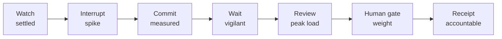

# Sentinel (FlytBase Sentinel) — User Journey Map

> Repo: `D:\portfolio porjects\flytbase` (branch `feat/map-spatial-os`) · Documented 2026-09-16 from latest code + repo direction docs.
> **Basis & honesty note:** no user research exists; journeys model the *intended* experience from `PRODUCT.md` (persona Asha authored there), `PORTFOLIO-DIRECTION.md`, and the design intent written into code comments. Screen IDs per [04-information-architecture](04-information-architecture.md). Empathy quadrants: [03-empathy-maps](03-empathy-maps.md).

## Persona journeyed

**Primary: Asha — the operator on authority** (authored in `PRODUCT.md`). A trained emergency-response operator monitoring wildfire risk and coordinating supervised drone operations. She must decide whether incomplete evidence is strong enough to **notify authorities**, then supervise containment and rescue without losing sight of exceptions, assets, or the limits of TALON. Secondary: relief operator and regional commander (handover / escalation recipients). The brief's numbers: 48-minute baseline, 90-second target.

## Journey 1 — Signal to authority notification (the 90-second arc)

| Stage | Operator does (scene) | Thinks (inferred from design intent) | Emotion | Pain point the design answers |
|---|---|---|---|---|
| 1. Handover into watch | Enters quiet watch (SEN-01); scans rails: sources, assets, zones | "What's normal right now?" | Settled alertness | Dashboards that show everything equally; **answer:** three separate voices (system prose, TALON panel, phase block) + one posture line |
| 2. The interrupt | TALON surfaces anomaly (SEN-02): converged evidence, 78% | "Why does it think that? What's it *not* seeing?" | Heightened focus | Black-box AI alerts; **answer:** evidence sources + confidence + limitations disclosed up front |
| 3. Commit resources | Dispatches Lidar-02 [confirm] (SEN-02→03) | "Worth a drone to check?" | Measured commitment | Costless-feeling AI actions; **answer:** confirm gate + agent evidence on the command |
| 4. The wait | Scout en route (SEN-03) | "What if it's smoke, not fire?" | Impatient vigilance | Dead time; **answer:** live telemetry + TALON prepares while operator reviews |
| 5. Review under uncertainty | Opens verification (SEN-04): 78% confidence, smoke-obscured visual, stale fuel data **disclosed** | "78% of what? Which source is weakest?" | Cognitive load — the crux | Confidence without provenance; **answer:** per-source freshness, uncertainty, missing evidence as first-class UI |
| 6. The human gate | Reviews authority packet (SEN-05); **a human sends it** [human-approval] | "Am I sure enough to wake up county dispatch?" | Weight of authority | AI that sends consequential messages; **answer:** "The 90-second promise ends here: a human sends the packet. TALON never sends it." |
| 7. Receipt | Packet acknowledged; receipt AUD-90-0847 retained | "It's on record that *I* sent this." | Steady accountability | Untraceable actions; **answer:** operator-linked audit receipts everywhere |

### Emotional curve (journey 1)

The design keeps the operator's load **peaked at the decision, not the choreography** — everything else (evidence assembly, packet preparation) is TALON's work made visible.

## Journey 2 — Arguing with the machine (the signature journey)

| Beat | What happens | Emotion | Designed answer |
|---|---|---|---|
| Disagreement begins | Operator declines TALON's escalation [confirm + stated reason] (SEN-04→11) | Conviction + doubt ("what if it's right?") | Dissent is structural, not silent — a reason is required |
| Contested watch | SEN-11: hypothesis alive at reduced weight; TALON's position preserved verbatim | Watchful respect | "A system that silently returns to normal teaches the operator their override was meaningless. A system that nags teaches them to stop reading." (code comment) |
| The appeal | New evidence crosses the raised bar → SEN-12; routed to a second authority | Vindication — *or* renewed tension | TALON may appeal, not repeat; the bar rose by the stated reason (+16 / +9 / +4 / +12) |
| Reconciliation | Ground truth arrives → resolve-dissent → outcome recorded **both directions**, including when TALON was wrong | Closure | "Dissent stays attached" — the artifact carries the answer |

This journey is the product's thesis made walkable: **the relationship between operator and copilot — argue, overrule, get overruled, reconcile — is the product.**

## Journey 3 — When the system breaks (failure journeys)

Satellite dies (SEN-14): confidence drops to 40%, spread widens ±200 m, containment authorization **blocked**, recovery = drone survey; the map honestly labels the fire edge "drone-weighted." Network degrades (SEN-16): latency 340 ms, lightweight vector overlays replace live feed, gates stay visible. Battery critical mid-rescue (SEN-13): TALON prepares a **supervised** handoff at 14%. Total loss (SEN-15): manual protocol takeover; restart returns to watch. Emotional design: bad news arrives **named, bounded, and with a way out** — never as a silent spinner.

## Pain-point → design-answer index (quotable)

| Pain point | Design answer (evidence) |
|---|---|
| AI that acts without consent | Gate taxonomy proportional to risk; hold-to-authorize on the most critical command (`commands.ts`) |
| Overriding AI that "doesn't stick" | Dissent records + raised re-raise bars + second-authority routing (`disagreement.ts`) |
| Trusting a confidence number | Source freshness, uncertainty, missing evidence, and limitations disclosed at review (`PRODUCT.md` purpose, verification records) |
| Failures that strand the operator | Fault scenes have exactly one real exit each; the "button that looked like an exit" bug is documented and fixed (`stateMachine.ts` comments) |
| Untraceable consequential actions | Audit receipts (AUD-90-0847, AUD-DIS-0847 prefix) + action-outcome verification records with deviation states (`verification.ts`) |
| Theatrical AI decoration | Anti-references in `PRODUCT.md`; the TALON mark can show "an AI being stopped" — blades physically close at human gates (`DESIGN.md`) |

*All rows trace to code or repo docs; emotions are the design's intended model, flagged for validation if real operator research lands later.*
