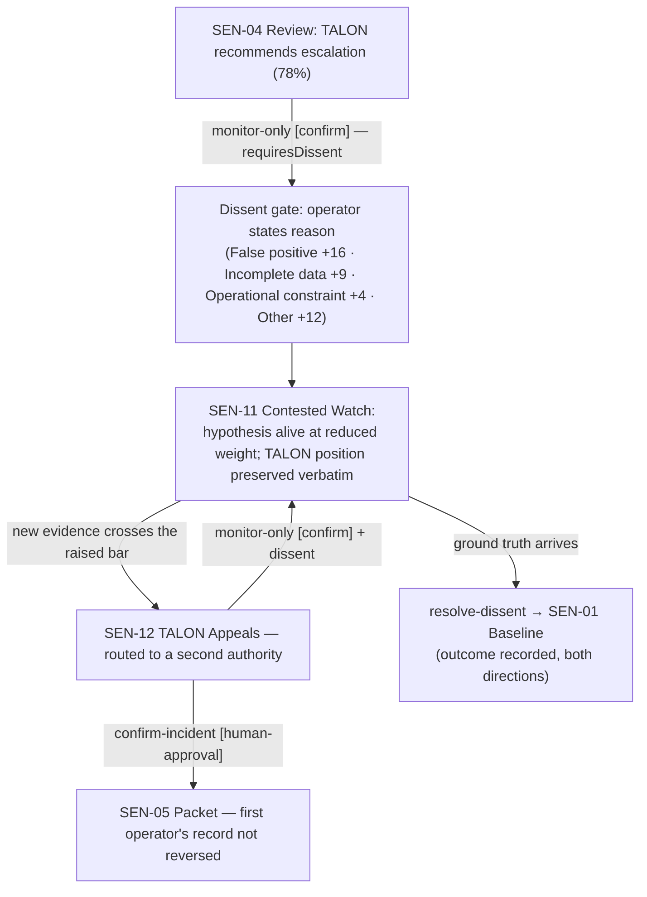
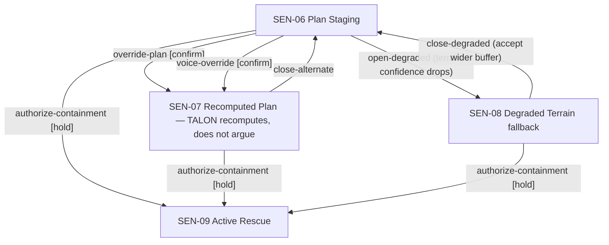

# Sentinel (FlytBase Sentinel) — User Flows

> Repo: `D:\portfolio porjects\flytbase` (branch `feat/map-spatial-os`) · Documented 2026-09-16 from latest code.
> Flows are reconstructed from the transition table (`domain/stateMachine.ts`) and command definitions (`domain/commands.ts`) — every edge shown exists in code with its gate. Screen IDs per [04-information-architecture](04-information-architecture.md); full state detail in [05-state-path-catalog](05-state-path-catalog.md).

## Flow map — the core flows at a glance

| # | Flow | Path skeleton | Key decision points | End states |
|---|---|---|---|---|
| F1 | The 90-second intelligence run (guided) | SEN-90 → 91 → 01 → 02 → 03 → 04 → 05 → 06 | escalate vs monitor (×2) | packet sent by human → operations |
| F2 | Operator overrules TALON (contested watch) | 04 → 11 → 12 → (05 or 11) | dissent reason; re-raise bar | reconciliation or second-authority escalation |
| F3 | Operator escalates past TALON | 03 → 05 (dissent, operator-initiated) | insist with stated reason | packet with TALON's objection attached |
| F4 | Containment planning & authorization | 06 → 07/08 → 09 | override; degraded acceptance | supervised execution |
| F5 | Live-ops exception handling | 09 → 13/21/10/22 → 09 | recall handoff; route shift; PIN | resumed nominal / handover complete |
| F6 | Infrastructure failure recovery | (injection) → 14/16/15 → recovery | deploy survey / relay / restart | planning resumed / manual protocol |
| F7 | Free exploration | SEN-90 → 01 + commands ∪ Review Dock | any gate | any scene |

## F1 — The 90-second intelligence run (the seller flow)

```mermaid
flowchart TD
    A["SEN-90 Entry: 'AI proposes. Operator authorizes.'"] -->|Begin Scenario| B["SEN-91 Brief"]
    B -->|simulation| C["SEN-01 Quiet Watch"]
    C -->|timer: alert| D["SEN-02 Anomaly Alert"]
    D -->|"dispatch-scout [confirm]"| E["SEN-03 Scout En Route"]
    D -->|"monitor-only (pre-recommendation)"| C
    E -->|timer: investigation complete| F["SEN-04 Operator Review · 78% confidence, limits disclosed"]
    F -->|"confirm-incident [human-approval]"| G["SEN-05 Authority Packet ready"]
    F -->|"monitor-only [confirm] + dissent"| H["SEN-11 Contested Watch"]
    G -->|"notify-authorities [human-approval]"| I["SEN-06 Plan Staging — 'a human sends the packet'"]
    I -->|authorize [hold]| J["SEN-09 Active Rescue"]
```

**Decision points:** dispatch vs decline (pre-recommendation, no dissent); confirm vs monitor-only (post-recommendation — dissent-bearing). **The 90-second promise ends at a human gate.** Guided timers make this repeatable for evaluators; free mode exposes the same chain via `surface-alert`.

## F2 — Operator overrules TALON (the disagreement flow, direction A)



**Design contract (from code):** refusing a TALON recommendation is *not* "do nothing" — it lands in contested watch, not baseline ("Baseline would erase the disagreement"). TALON may **appeal, not repeat**: the bar rises by the stated reason; after a second human decline, "the watch continues, the bar does not rise again."

## F3 — Operator escalates past TALON (direction B — "the riskier direction most AI products ignore")

Investigation (SEN-03) → `confirm-incident` at 46% confidence → **requiresDissent** → human-approval gate → SEN-05 with `escalationBasis: "operator-initiated"` — the packet records *whose call it was* and carries TALON's objection ("Evidence sits at 46%… I do not have grounds to recommend escalation yet") verbatim. Authority is human, so the system complies — and the record stays honest.

## F4 — Containment planning & authorization



**Decision points:** tactical override vs staging picture; degraded acceptance (wider ±200 m buffer). **End:** hold-to-authorize gesture on a critical action → supervised execution begins (mode flips to `rescue`).

## F5 — Live-operations exception handling

From SEN-09: battery critical (SEN-13: drone at 14% → acknowledge-handoff [confirm] → Scout-03 takes over, execution resumes) · Route A blocked by smoke (SEN-21: partial evacuation shown **honestly** → authorize-route-b [confirm] → resume) · shift change (SEN-22: authority ambiguous until the incoming lead takes it by PIN; outgoing record stays attached) · signal degraded (SEN-10 → deploy-backup → resume).

## F6 — Infrastructure failure recovery

Faults arrive by injection (telemetry), never by operator navigation. Each has exactly one real exit: satellite loss → deploy-survey [confirm] → planning resumes with drone-weighted evidence; network degraded → relay-field-intel [confirm] → gates reopen; total loss → InfrastructureLossTakeover → manual protocol → system restart → baseline. The code comment is quotable: an earlier "recovery" button assigned a drone and *left the operator in the degraded scene forever* — "the button looked like an exit and was not one."

## F7 — Free exploration (evaluator mode)

Entry → Explore freely → SEN-01 with full command surface + Review Dock (20 scenes) + scenario switcher + `?scene=` deep links. Every gate still applies in free mode — exploration never bypasses human-approval gates. `?core=1` strips the Review Dock for shareable stills.

## Flow-design rules worth quoting

1. **Every consequential move passes a gate proportional to its risk** — confirm for staging, human-approval for authority/evacuation, hold-to-authorize for the most critical.
2. **Two-way disagreement with memory** — both override directions create records; reconciliation answers them in both directions, including when TALON was wrong.
3. **Exception UX = one honest surface** — affected sources/agents, blocked commands, fallbacks, confidence impact, recovery command, audit text, spatial uncertainty, all in one place.
4. **Guided repeatability** — the simulation mode makes the 90-second story demonstrable on demand without weakening free mode's gates.
