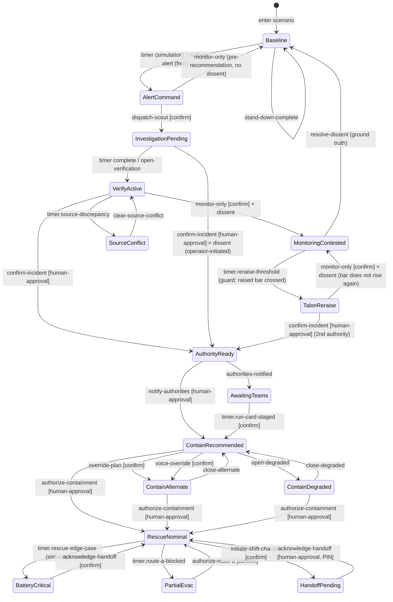

# Sentinel (FlytBase Sentinel) — App State & Path Catalog

> Repo: `D:\portfolio porjects\flytbase` (branch `feat/map-spatial-os`) · Documented 2026-09-16 from latest code.
> Source of truth: `domain/stateMachine.ts` (the transition table, quoted reasons), `domain/exceptions.ts`, `domain/talonSurface.ts`, `domain/disagreement.ts`, `domain/verification.ts`, `mockData.ts`. Scene IDs defined in [04-information-architecture](04-information-architecture.md).

## 1. Global state

| State | Values | Source | Governs |
|---|---|---|---|
| `scene` (SceneId) | 20 authored scenes | `SentinelShell` + `stateMachine.ts` | The whole interface |
| `experienceMode` | `entry` → `brief` → `simulation` → `free` | `SentinelShell.tsx:182` | Guided run timers vs free exploration |
| `mode` (OperationalMode) | `scan` / `verify` / `contain` / `rescue` | transition effects | Workflow phase (Intelligence ⇄ Operations), density |
| `TransitionContext` | `experienceMode`, `mode`, `authoritiesNotified`, `edgeCaseFired`, `dissent`, `evidenceConfidence` | `stateMachine.ts` | Guard evaluation on every edge |
| `authoritiesNotified` | boolean | transition effects | Gate on `notify-authorities` (fires once) |
| `dissent` (DissentRecord) | direction (`talon-escalates`/`talon-holds`), reason, operatorNote, talonPosition (verbatim), talonConfidence (78%/46%), auditId, re-raise bar | `disagreement.ts` | Contested-watch behavior; TALON appeal eligibility |
| Escalation basis | `talon-recommended` / `operator-initiated` | transition effects | Whose call the packet records |
| Session gateway | connected / reconnecting (<2 s) / offline | `useScenarioSession.ts` | Live telemetry frames; stub by design |
| Scenario | S-01…S-06; authored mirror vs live source | `ScenarioSwitcher.tsx` | Deterministic default; fetch failure is a state, not an error |
| TALON surface posture | `quiet` / `working` / `gated` / `alert` / `contested` / `blocked` | `talonSurface.ts` (single derivation) | Ring color, mark state, posture line, gate label |
| TALON mark state | `watching` / `listening` / `searching` / `solving` / `gated` / `executing` / `blocked` / `receipt` | `DESIGN.md` + `TalonMark` | The 8 signatures; `prefers-reduced-motion` keeps static geometry |
| TALON conversation | watching / input (typed·voice) / review / checking / executing / receipt / cancelled / error | `TalonSession.tsx` | Copilot session view |

## 2. Scene transition map (operator-reachable edges, from the table)

Fault-injected scenes (no inbound operator edge **by design**; each has a recovery edge):

| Scene | Entered by | Recovery edge | Recovery result |
|---|---|---|---|
| SEN-14 satellite-feed-loss | telemetry injection | deploy-survey [confirm] | → ContainRecommended (fusion recovers) |
| SEN-16 network-degraded | telemetry injection | relay-field-intel [confirm] | → ContainRecommended |
| SEN-15 infrastructure-total-loss | telemetry injection | system.restart | → Baseline (manual protocol ends) |
| SEN-10 rescue-signal-degraded | telemetry injection | deploy-backup [confirm] | → RescueNominal |

Universal exits from `*`: `abort-mission` [confirm, modal, destructive] → Baseline (resetIncident); `stand-down` → Baseline after debrief.

## 3. Command state catalog (26 definitions, `domain/commands.ts`)

Gate taxonomy observed: `none` / `confirm` / `human-approval` / `hold`; risk levels `low` → `critical`; modals: mission, authority, handover, abort. Highlights (quotable):

| Command | Gate | Risk | Notable |
|---|---|---|---|
| surface-alert | none | low | Raises the interrupt in free exploration |
| dispatch-scout | confirm | medium | agentEvidence: Sensor Fusion, Drone Perception |
| confirm-incident | **human-approval** | high | TALON *prepares* the packet; agentEvidence adds Governance |
| notify-authorities | **human-approval** | critical | modal authority; receipt AUD-90-0847; "TALON never sends it" |
| authorize-containment | **hold** | critical | Hold-to-authorize gesture on the most consequential action |
| emergency-evacuate | human-approval | critical | tone `fire` |
| abort-mission | confirm (modal abort) | critical | destructive; resets incident |
| shift-handover | confirm (modal handover) | medium | PIN transfer; outgoing record stays attached |
| override-plan | confirm | high | TALON recomputes rather than argues |
| monitor-only | none | low | Becomes dissent-bearing after a TALON recommendation |

Every command also carries: intent sentence, blockedBy/disabledReason, receipt fields where applicable.

## 4. The dissent model as state (`domain/disagreement.ts`)

Three coded rules: **the human decides** (TALON never withholds or executes); **rejection is not deletion** (overruled hypothesis stays alive at reduced weight with a *raised* re-raise bar); **dissent stays attached** (recorded with verbatim TALON position + confidence, answered when ground truth arrives — including when TALON was wrong).

Re-raise bar increments by stated override reason (observed): False positive +16 · Other +12 · Incomplete data +9 · Operational constraint +4 — a strong claim about the world demands stronger new evidence. TALON's recorded positions: 78% ("talon-escalates") vs 46% ("talon-holds"). Dissent IDs: `DIS-REJ-0847` / `DIS-ESC-0847`; audit prefix `AUD-DIS-0847`.

## 5. Exception states (observed, `domain/exceptions.ts`)

Each exception carries: severity, affected sources + agents, **blockedCommands** (e.g. `authorize-containment`), fallback inputs, confidence impact ("reduced to 40%. Spread margin increased ±200 m."), recommended recovery command, audit text, map impact ("labels the fire edge as drone-weighted"), and spatial uncertainty (margin meters, affected zones, basis, timestamp). Cataloged: satellite-feed-loss · network-degraded · battery-critical · infrastructure-total-loss.

## 6. Verification receipts as state (`domain/verification.ts`)

Action-outcome verification records: expected vs observed outcome, `deviationState` (e.g. within-tolerance), deviation summary, timestamp, linked audit + activity-log IDs. Observed records: dispatch (on-station 63 s inside threshold), evidence review (78% confidence with limitations disclosed), authority packet (receipt AUD-90-0847 retained). These make "the system checks itself" part of the UI, not just the build.

## 7. Experience-mode states (guided run)

`entry` → `brief` → `simulation` (timed beats: alert surfaces, investigation completes, rescue edge case fires once — `guard: inSimulation && !edgeCaseFired`, end card) → `free` (Review Dock visible; `?core=1` hides it). Guided-run exists so the 90-second story is repeatable for evaluators; free mode allows every command path.

## 8. Machine audit (in code, runnable)

`npm run verify:machine` executes `auditMachine()`: unreachableScenes, faultOnlyScenes, deadEndScenes, totalTransitions. The audit itself is quoted in `PORTFOLIO-DIRECTION.md` as case-study evidence; a red gate invalidates published copy. Companion scripts: `verify:signals`, `verify:flows`, `verify:routes`, `verify:map`, `eval:talon`.

## 9. Complete scene ↔ state cross-reference

SEN-01 (quiet / alert-ready) · SEN-02 (alert, gate none) · SEN-03 (scout en route, timer-driven) · SEN-04 (review, source-conflict branch) · SEN-05 (packet ready, human-gate) · SEN-20 (paused verification) · SEN-06/07/08/19 (contain variants: recommended / alternate / degraded / awaiting-teams) · SEN-09 (nominal rescue) · SEN-10/13/21/22 (rescue exceptions: signal / battery / partial-evac / handover) · SEN-11/12 (contested watch / TALON appeal) · SEN-14/15/16 (fault-injected) — all in [04-information-architecture](04-information-architecture.md) §3C with labels/notes. Global states §1 + commands §3 + dissent §4 + exceptions §5 + receipts §6 complete the state space.

## 10. Flagged / not verified

- Guided-run timer values (alert at ~4 s etc.) live in `SentinelShell` effect code; not extracted beat-by-beat here.
- The session gateway is a stub; `server/index.ts` exists but live behavior was not run (read-only analysis).
- `rescue-partial-evac`, `contain-awaiting-teams`, `handoff-pending`, `verify-source-conflict` are "promoted states" (vault 03 §2 per code comments) — reachable in the table; their in-shell visual treatment was not individually screenshotted.
- Reachability audit results are produced by the script, not hardcoded here — run `npm run verify:machine` for the current verdict.
