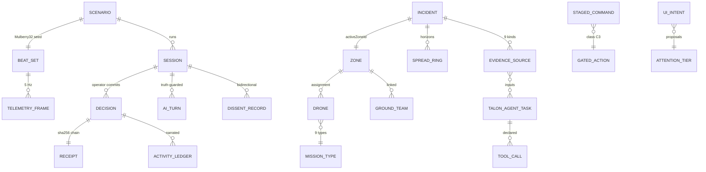
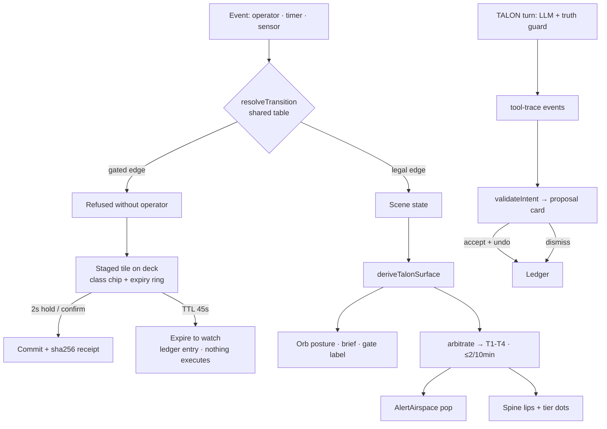

# TALON End-to-End System Report — data, product decisions, UX, build truth

> **status: canonical — system report** (2026-09-28). Answers, against the latest build: what the data components are, what the bottom deck shows, the drone and map/spatial systems, TALON's product decisions and the UX that supports them, every repo document old→new, the LiveKit-derived backend upgrade plan, the mock-simulation database build-up, and the consolidated missing list. Method: three parallel research sweeps (build internals; every doc old→new; LiveKit architecture) + this session's build/audit evidence. Rubrics applied: **mermaid** (diagrams only where a list would flatten), **pm-critic** (§5.3, P0–P3 adversarial findings), **web-design-guidelines** (§5.4, terse file:line), **gpt-taste** (output bar: no filler labels, no emoji; its AIDA/GSAP machinery targets marketing pages and is consciously not applied to an ops dashboard), **hindsight** (process lessons persisted to project memory, summarized in the final chat message).

---

## 1. Data components inventory

### 1.1 The domain model (what actually exists in code)

| Entity | Source of truth | Shape (key fields) | Consumed by |
|---|---|---|---|
| **Incident** `INC-2024-0847` | `mockData.ts:96` | id, location "Grid 4C · Forest ridge", coords, detectedAt, operator A. Rao, aiConfidence 78, windVector "NE 38° · 18 mph", fireBehavior, footprint ~0.4 ha, spreadRate 0.8 km²/h, structuresAtRisk 47, evacuationScope 47, activeZoneId | Deck truth cluster, IntelPanel hero, Mind telemetry fallback, modals |
| **Incident queue** (1 active + 2 read-only) | `mockData.ts:117` | `kind: "active"\|"summary"`, dataFreshness | ScenarioSelector / queue control (multi-incident is deliberately read-only) |
| **Zones** ×5 | `mockData.ts:168` + `map/zones.ts` | forest-north, buffer-west/east, residential-west/south; polygon = pixel string in native 1691×914 space, category, boundaryColor, center, risk/spread/terrain/structures + 4 short chips | 2D polygons, 3D ribbons, dispatch snapping, Context Inspector, intents |
| **Spread rings** ×3 | `mockData.ts:262` | 15/30/60-min, radius 118/196/292, tone, dash | 2D dashed circles around the anomaly, 3D dashed rings, age-badge gap (G-08) |
| **Anomaly** | `mockData.ts:157` | pixel position, confidence 40, zoneId — "UNVERIFIED · GRID 4C" chip pre-verification | 2D/3D marker, detection story |
| **Drones** ×10 / 5 classes / 9 mission types | `mockData.ts:320,670`; `tokens.ts:788-795` | classes: surveillance, thermal-lidar, guidance-relay, evacuation-guidance, multi-role; status: available/en-route/assigned/holding/signal-degraded; battery, signal, x/y, zoneId, eta, gridLabel | §3 below (all drone surfaces) |
| **Ground teams** ×3 | `mockData.ts:484,674` | alpha (staged, perimeter), bravo (deployed, "HR 165 · VIS 5m" vitals string), charlie (available) | TeamMarkers, Context Inspector, EvacuationModal, NotifyTeamsModal |
| **Evidence sources** ×9 kinds × 5 statuses | `tokens.ts:499-521`, `talon.ts:414` | thermal, satellite-ir, drone-visual, lidar, wind, fuel, terrain, burn-history, structure-road; `{status, confidence, lastUpdated, note}` | Mind console chips, IntelPanel freshness matrix, TALON fusion, verify-source-conflict story |
| **Signal series** (thermal / structures / confidence) | `talon.ts:327-421` (`SIGNAL_PROFILES`, `getSignalHistory`) | per-scene series, last point = displayed value contract; 90 s convergence clock | C1 ConvergenceCard sparklines + arc gauge, audit:signals |
| **TALON agent tasks** ×11 | `talon.ts:542-890` | `{shortLabel, category(6), status(5), currentTask, toolCalls[], confidence?, blocker?}` | Mind console tool trace, workforce surfaces |
| **Dissent records** | `domain/disagreement.ts` | direction, reason, talonPosition verbatim, talonConfidence, auditId DIS-REJ/DIS-ESC, reRaiseThreshold (+16/+9/+4/+12 bar) | ContestedWatch, ReRaise brief, packet dissent note |
| **Authority packet** AUD-90-0847 | `talon.ts:983-1007` | status drafting\|ready\|sent, confidence, grade, agency, evidenceSummary, missingData[], humanGate | Packet modal, Mind console, G2 gate — **NotifyAuthoritiesModal still hardcodes its copy** (finding P2, §5.3) |
| **Staged command + expiry** | `domain/staging.ts` | TTL 45 s (`?stagedTtlMs=`), `expiredActions[]` demoted in syncState; expiry logged, never executes | Deck tiles w/ countdown ring, flow-tested |
| **UI intents** | `domain/intents.ts` | focus_map_zone / open_panel / pin_evidence / compare_plans; validateIntent vs live state; seeds per scene | Mind console proposal cards, UndoToast, ledger |
| **Attention signals** | `domain/attention.ts` | tier T1–T4, kind gate/exception/evidence/routine, ISA-18.2 budget ≤2/10 min, phase density | AlertAirspace pop, spine tier dots, kill-test |
| **Operational exceptions** ×6 | `domain/exceptions.ts` | affectedSources, blockedCommands, fallbackInputs, confidenceImpact, mapImpact, spatialUncertainty {marginMeters, affectedZoneIds} | Exception surfaces, map envelopes (margin/1691 UV), right-rail takeover |
| **Containment plans** (recommended/alternate) | `mockData.ts:541` | spread{baselineRate, residualRate, direction, uncertaintyMargin}, exposure{inPath, residualRisk, routeExposure}, protection, resourceCost, confidence, eta | C-inline plan comparison, map rings, G2 reasoning |
| **Activity ledger** | `mockData.ts:730` + `SentinelShell appendLog` | `{id, ts, actor AI\|TALON\|Operator\|System, type, text, severity}`; scene-stacked history | ActivityLogPanel, P10, handover, debrief |
| **Server ledger** | `server/db.ts:92-109` | `decisions{action_id, operator_id, clock_ms, sha256(prev+action+operator+clock)}` + events/dissent_records/ai_turns | `/audit/:sessionId` re-derivation, 409 on tamper |
| **Telemetry frames** | `server/scenarioEngine.ts:29-39` | 5 Hz `{clockMs, scenarioId, thermalF, structuresCleared, confidence, windBearing, windSpeedKts, lidar02EtaS, sceneHint}`, ±3 °F deterministic jitter | `?feed=live` → TelemetryStripV2, deck thermal, LIVE-SIM badge |
| **Rescue progress** | `mockData.ts:678` | cleared 12/47, routeA "Active", routeB "Standby", FD ETA | Route Capacity matrix, rescue scenes |
| **System health** | `mockData.ts:657` | sensor grid 22/22, patrol coverage 68 %, wind, road telemetry | IntelPanel strip |

### 1.2 Relationships (the part a list flattens)



### 1.3 Two data modes, one view model

Scripted (canonical, deterministic, gates-friendly) and live (`?feed=live`, 5 Hz WS frames from the Fastify gateway) feed the **same** view models; panels cannot tell the difference except by the `source: "scripted" | "live"` label and the LIVE-SIM badge. What live mode does **not** yet drive: scene transitions (frames carry `sceneHint` but the client state machine still runs scripted timers), per-drone telemetry, and evidence-source freshness (§9).

## 2. The Command Deck — exactly what the bottom bar shows now

It is not a navigation bar anymore; it is the re-homed navbar + command plinth (docs 03 §Architecture). At 88 px, `materialGlass.deck`, full width minus 12 px margins (`shell2/CommandDeck.tsx`):

| Slot | Data shown | Source |
|---|---|---|
| Truth cluster (left) | Incident id `INC-2024-0847` · UTC clock · mode pill (scan/verify/contain/rescue, tone-mapped) · T+ mission clock · **LIVE-SIM** badge (connected/offline) when live | `INCIDENT`, `state.mode`, `simTime`, `incidentElapsed`, `liveSession.connected` |
| Center bay | TALON cradle: 60 px circular inlay, ring in the surface tone, TalonMark 40 px in the current of the 8 postures (with gated/blocked/receipt glyphs) · posture eyebrow (`HUMAN AUTHORIZATION REQUIRED`, `QUIET WATCH`…) · one-line consequence brief (`Send Authority Packet is staged. The authorization is yours.`) · voice bars (idle dots / listening wave) | `deriveTalonSurface(state, {burnPermitVerified})` — the single-source posture |
| Right | Up to 3 command tiles: label + **class chip (C2 staged / C3 gated)** + **expiry countdown ring** on the staged recommendation + disabled states; DangerMenu actions intentionally deferred to P7 polish | `state.actionSurface.primary/secondary`, `GATED_ACTIONS`, `stagedExpiresAt` |
| Above the deck (alert airspace) | Exactly one arbitrated interrupt ("Gate waiting — …" / "Degraded — fallback evidence active") with its tier dot; empty when the board is clean; LIVE-SIM badge mirrors here | `arbitrate(attentionSignals, budget)` |

**Not yet on the deck** (queued): quiet-watch affordance balancing the empty right side at baseline; receipts indicator; secondary "more" menu; mic push-to-talk (visualizer is display-only).

## 3. Drone components — everything that exists

**Fleet:** 10 drones / 5 classes / 9 mission types (`DroneClass`, `DroneMissionType` — tokens.ts:788-795): scout-01/03 (surveillance), lidar-02 (thermal-lidar), relay-01/02/03 (guidance-relay), herald-01/02 (evacuation-guidance), vanguard-01/02 (multi-role).

**Every surface a drone appears on:**
1. **2D map markers** with per-class glyphs (diamond/relay-arcs/triangle/octagon/dot — `AgentMarkers.tsx:5-29`), status colors, click-select, **drag-assign** (drop snaps to zone centroid via road graph, logs a TALON-snapped override, forces contain-alternate in contain mode — `SpatialMapCanvas.tsx:499-604`).
2. **Animated road transits** — 1600 ms easeInOut along the 24-node/34-edge road graph (`agents.ts:57-88`).
3. **DroneFleetPanel "Asset State"** (LeftPanel:391-485) — search/filter, avg battery, mission clusters (Needs attention / Evidence collection / Field tasking / Relay & guidance / Standby).
4. **Context Inspector** selected-drone hero (LeftPanel:276-305).
5. **Mind console v2** — `FleetRowsV2` (top-5, BAT/SIG hairline bars, low-battery tier) + `TelemetryStripV2` (live-frame thermal/wind/cleared).
6. **3D EXPLORE** — asset rail (first 4 roster drones), tether SVG, dispatch proposal card ("TALON · PROPOSAL — NOT EXECUTED", ETA = road metres / 16 m s⁻¹, min 6 s), CSS2D name+battery labels, dispatch route Line2 (`droneDispatch.ts`, `Map3DExplorer.tsx:578-613`).
7. **MissionBriefModal** — the 7 dispatch actions (`MISSION_BRIEF_DATA`), candidate-drone resolution (class match → multi-role → any available/holding), coverage-vs-speed toggle, TALON voice-revision flow.
8. **TALON agent tasks** — 4 drone-relevant of 11: drone-perception, drone-control (geofence, assign-drone — supervised), resource-readiness ("Drone-03 battery critical"), sensor-fusion (consumes drone-visual).
9. **Battery-critical interrupt** — recall Lidar-02 "14% · RTB" / coverage Scout-03 "ETA 00:42", `operator.acknowledge-handoff` gate.
10. **Route Capacity matrix** (RightPanel:292-315) — route A/B + FD ingress.

**Drone gaps:** the "Map | Grid" toggle (`SurfaceMode "drone-grid"`) is **vestigial — nothing renders the grid** (archive-only); Scout-02 exists only in prose/log copy; no per-drone live telemetry strip (frames are incident-level); no dock/prefetch roll-up (ch06 G-05); no geofence/TFR layer (G-10).

## 4. Map canvas & spatial system — everything

**2D (`SpatialMapCanvas.tsx`, 1186 lines)** — render order: backdrop image inside its own slice SVG (`map-preincident.png` pre-verify, oblique `sentinel-map-overhaul.png` after — the doc-10-diagnosed swap, still gated only by scene) → depth haze → vignette → one `viewBox 0 0 1440 900` overlay SVG: route-arrow defs, 3 spread rings, evidence uncertainty envelopes (margin ÷ 1691 UV), zone polygons (per-category dash/stroke), corridor road ghost (contain/rescue), SCOUT INVESTIGATION + route-a/route-b egress + responder ingress RouteLines (flow-dash animated), transit polylines, anomaly marker, drone/team markers → DOM label layer with **command-dock collision suppression** (labels suppressed inside the dock zone). **Zone envelope widget** (±margin stepper, clamp −0.04…+0.06) bottom-right.

**Camera law (the important fact):** the 2D view is a single `(u,v,zoom)` state **seeded only by 3D handoff — there is no user pan/zoom in 2D at all**. The slice law (`pointerToNative`, uniform scale + centered offsets) is shared by backdrop, overlay, and pointer inverse — verified by verify:map's 9 checks.

**Graphs:** roads = hand-authored 24 nodes / 34 edges (arterial/local/service × drone/team/both) with Dijkstra (`roads.ts`); NAMED_ROUTES = route-a, route-b, responder, investigation (`routes.ts`). Zone margin expansion is per-vertex centroid scaling (`zones.ts:44`), not a true offset buffer.

**3D (`Map3DExplorer` + `runtime/`)** — world: 6000×3250 m Encinal Canyon; DEM 400×220 @15 m (min −0.9 / max 491 m); **2495 OSM buildings**, 873 roads; vegetation 260×118 ESA classes; authored fire band + 3 smoke sprites + wind overlay. Render: terrain 240×130 (VEX 1.6), roads 2 merged meshes, buildings **one InstancedMesh**, trees capped 6000, LWIR mode (prebaked vertex colors + fog + 4 sensor cones, persisted via localStorage), **on-demand render loop (idle = 0 draws)**, HUD "N/19 CALLS" — currently 6 overlay + 12 world = 18. Overlays: batched zone-ribbons (draped +4 m), 3 spread rings, 2 egress corridors with state colors + 620 ms pulse, CSS2D labels, dispatch line. Everything derives from the 2D data via one px→metres projection — 3D cannot disagree with 2D.

**Scanners/sensors — the honest inventory:** there is **no** dedicated scanner entity. "Sensors" are: the drone roster (thermal-lidar, EO), the 9 evidence kinds, "sensor grid 22/22" (one system-health string), and the 3D LWIR sensor cones. **No RAWS weather station entity** — wind is a string on the incident ("NE 38° · 18 mph") plus live-frame `windBearing/windSpeedKts`; ambient temp/RH exist only in server scenario rows, rendered nowhere.

**Map utils that do NOT exist:** no measure tool, no scale bar, no north arrow, no live coordinate readout, no layer toggles (C4), no geofence/TFR, no perimeter diff slider (C5), no hotspot list (C7) — the 21-component spec's C4-C7 remain unbuilt.

## 5. TALON end-to-end — product decisions, UX, UI support

### 5.1 The product decisions (all still standing, now enforced in code)

1. **Reasoner strapped to a constitution** — LLM proposes; the shared transition table disposes; a hijacked model yields "an odd sentence in the chat log," never a wrong action (server 403s gated edges by construction).
2. **Three-tier human authorization** — C1 telemetry, C2 staged (now **really** expires: 45 s, logged, never executes), C3 explicit hold (2 s radial ring, release = cancel).
3. **Single-source truth surface** — `deriveTalonSurface()` derives posture/mark/tone/gate label; the orb, deck, and mind console cannot disagree.
4. **Rule of One + anti-nagging** — one plan, one interrupt; re-raise only on new evidence crossing the bar.
5. **Bidirectional dissent with memory** — verbatim positions, audit ids, re-raise thresholds.
6. **Receipts, not authority** — hash-chained ledger; the packet is a draft TALON never sends.
7. **Attention, never furniture** — TALON proposes information (intents), the engine validates, the operator disposes; ISA-18.2-flavored budget (≤2 interrupts/10 min); gates physically live only in the deck and never move mid-hold.
8. **Honesty boundary** — targets labeled as targets, LIVE-SIM labeled, degraded = authored fallback with a visible state, no invented telemetry.

### 5.2 The UX model and the control loop

Mind (right, 380 px: convergence hero · session · tool trace · evidence chips · proposals · telemetry · fleet) / Hand (deck: posture + brief + staged tiles + hold) / Senses (spines: peek lips + tier dots, expand-on-tap) / Airspace (one interrupt, quiet = clean). Two renderings of one state — thread and orb cannot disagree because both derive from the same functions.



### 5.3 pm-critic — adversarial findings (P0–P3)

**P1 — "TALON controls information" is still majority-read-only.** Intents exist and are validated, but `open_panel` acceptance only logs (panel focus not wired), `compare_plans` queues. Until accepts mutate real surfaces, the demo claim is a proposal viewer. *Fix: wire open_panel to RailStack pinned state + compare_plans to the plan-comparison section (1 session).*

**P1 — the 2D map has no operator camera.** Zero user pan/zoom in 2D contradicts "the operator owns the map" and the old map-pan plan; v2's full-bleed map makes fixed framing more visible. *Fix: wheel-zoom + drag-pan on the existing (u,v,zoom) state (the slice law already supports it).*

**P1 — evac GO chips don't exist (ch06 G-15).** Corridor status is two strings; the 30-row decision matrix's #20 needs per-zone time-to-impact + GO chips + corridor status at G3. *Fix: P11 evac cards with GO chips (data exists in RescueProgress + zones).*

**P2 — NotifyAuthoritiesModal is a hardcoded replica** of the packet instead of consuming `getAuthorityPacket(scene)` — two sources of truth for the product's most governance-heavy artifact. *Fix: bind the modal to the packet fixture (small, high-trust-value).*

**P2 — the confirmation protocol is an error wall, not a round trip.** Server hard-403s gated commands (correct authority, wrong ergonomics); LiveKit's HITL pattern (§7) offers pending_confirmation → operator completes the tool. *Fix: adopt pattern #4 in the gateway.*

**P2 — SceneHint dead-ends.** Live frames carry `sceneHint` but the client machine ignores it — live mode can't actually walk a scenario autonomously. *Fix: server-authoritative scene events over the WS (database build, §8).*

**P3 — ghost entities.** Scout-02 (prose-only), the vestigial drone-grid toggle, EVACUATION_ROUTES/RESPONDER_ROUTE legacy consts superseded by NAMED_ROUTES. *Fix: delete or implement — dead data erodes trust in an honesty-first product.*

### 5.4 web-design-guidelines — findings (new shell2/kit code only)

```text
## src/app/components/shell2/AttentionSpine.tsx
AttentionSpine.tsx:63 - tablist/tab without role="tabpanel" on the expanded panel
AttentionSpine.tsx:124 - width transition not gated by prefers-reduced-motion
AttentionSpine.tsx:79 - tabs are buttons ✓ but no arrow-key roving focus for the tablist

## src/app/components/shell2/AlertAirspace.tsx
AlertAirspace.tsx:31 - interrupt surface lacks role="status"/aria-live (T1 must announce)

## src/app/components/shell2/CommandDeck.tsx
CommandDeck.tsx:37 - deck lacks a landmark role/aria-label (role="toolbar" or region)
CommandDeck.tsx:96 - posture line is aria-visible ✓ but TranscriptBars idle state announces nothing — fine; tiles: add :active scale press feedback

## src/app/components/kit/core.tsx
core.tsx (CommandTile) - no :active transform (emil row, same finding)
core.tsx (PanelGlass) - div-as-surface is fine (no click handlers) ✓

## src/app/components/kit/feedback.tsx
feedback.tsx (UndoToast) - role="status" ✓ auto-dismiss ✓; add pause-on-hover to match sonner behavior

## passes
HairlineBar role="meter" + aria-valuenow ✓ · ArcGauge role="meter" ✓ · GlassToggle role="switch" + aria-checked ✓ · icon-only buttons all labeled ✓ · URL state deep-linked (?layout/?feed/?scene) ✓ · keyboard.css focus-visible ✓ · destructive actions confirmed/undoable ✓
```

## 6. The repo's documents, old → new (generation map)

- **Gen 0 — case-study drafts** (`docs/archive/old-case-studies/`): 7 docx + 17 HTML drafts v1→v8.1. The writing journey; constrains nothing.
- **Gen 1 — master-spec era** (quarantined 2026-09-14): `sentinel-ai-upgrade/` (24 files) built the decision-archive discipline and the two-phase 90 s breakthrough — its README carries 5 known-false claims the build contradicts by design. `SENTINEL-V2-Master-SPEC.md`: "reasoner strapped to a constitution" + one TRANSITIONS table on both sides — **fulfilled literally** by `server//command`. `flagship-quality-upgrade`: contributed B1 expiry-never-execution — **implemented last week**. `talon-backend-scenario-master-plan`: detection-provenance data — partially fulfilled; run-card/drawdown behaviors open.
- **Gen 1a — `original-specs/`**: verbatim copies of Gen 1 masters + quarantine README. Read-only.
- **Gen 2 — vault era** (00–09 + foundation audit): the constitution, receipts, derived voice, three-tier HITL — all fulfilled; counts stale (20/39 is real); doc 10 marked historical (diagnosis kept, four prescriptions rejected). **Open:** P7 promote.
- **Gen 3 — untracked research set** (Sep 16–22): `case-study-research/` (journeys/flows/empathy/IA/state-catalog — accurate for the default shell, pre-v2); `sentinel-information-design/` (11 chapters: 30-row decision matrix, 21-component spec, 15 gaps — its blocking gaps tiered-alerts + live-feeds are now **fulfilled**; multi-incident remains a locked non-goal); `sentinel-layout-thinking/` (6 advisor voices — D2 fulfilled them nearly point-for-point; tablet recomposition open); `sentinel-reports/` (flow atlas + F1 run + sources).
- **Gen 4 — redesign-2026 00–06 + build**: the current truth; the build matches it.

**Stale docs needing a header/update (the actionable list):** `PRODUCT.md:15` ("no production AI" vs `?feed=live`); `PORTFOLIO-DIRECTION.md:4,46` (dead pointer to archived master spec); `DESIGN.md` (pre-v2 layout + token vocabulary — P7 rewrite pending); `case-study-v2-framing.md:9` (15-min baseline vs 48-min lock); `interactive-case-study-plan.md` (parked — keep/kill); `map-pan-extension-plan.md` (premise shifted under v2); vault `00`/`03` (counts); `README.md:33-40` (stack omits server/ + flags); `spatial-os-portfolio-prototype-test.md` (add "pre-redesign layout" header so its 9/10 isn't quoted for v2).

## 7. LiveKit Agents → the TALON backend upgrade plan

LiveKit's model: an **AgentServer** boots a **job** per session; the agent is a **peer participant in a room**; tools are schema-validated functions (`@function_tool`, docstring = description, `RunContext` carries the session); agent↔UI rides **data messages / RPC / participant attributes** (`agent_state: listening|thinking|speaking`); HITL is "a tool that awaits external confirmation"; a built-in test framework asserts event sequences with LLM judges.

**Adopt next (ranked, mapped to the gateway):**
1. **Typed tool registry** — one source of truth for the 5 TALON tools: name + description + zod-validated args + a session context object (ledger, transition table). Replaces the ad-hoc truth-guard strings with a self-documenting registry.
2. **Tool-trace event stream** — every `/talon/message` turn emits `{tool, args, result, latency, gated?}` events over the WS → the Mind console's tool trace becomes **real**, not scripted.
3. **`talon_state` attribute** — one posture field (`thinking|proposing|degraded|awaiting_operator`) broadcast per turn; the UI subscribes instead of inferring from prose. Degraded becomes a typed state end-to-end.
4. **Confirmation round-trip for gated actions** — `propose_transition` on a gated edge returns `pending_confirmation` + emits a request event; the operator's existing hold completes the tool. Same authority, protocol-level instead of a 403 wall (resolves pm-critic P2).
5. **RPC-framed UI intents** — correlation-id request/response for `ui.focus_panel` etc., with client-side handler registration.
6. **LLM-judge scenario tests** — port `eval-talon.mjs` toward asserting event sequences (`is_function_call`-style) per scenario, not just string refusal.

**Explicitly not adopted:** STT→TTS pipelines and realtime audio models (Sentinel is text-driven; Web Speech is scripted), WebRTC rooms (the 5 Hz WS is the right transport — borrow the *protocol*, not the media plane), job-per-session subprocesses, LiveKit Cloud auth.

## 8. Database build-up for mockup situation simulation

**Already real:** SQLite with 6 tables (`scenarios, sessions, events, decisions, dissent_records, ai_turns`), scenarios S-01…S-06 seeded on boot (`server/scenarios.ts`: 90–600 s, 8–12 beats each, zone states, drone roles/positions/battery, decision points with gates), deterministic Mulberry32 jitter keyed by (seed, second), beats appended to the session event stream.

**Build-up plan (v2 schema — additive, no breaking change):**
1. **Persist the beat scripts** — `scenario_beats(scenario_id, at_s, thermal_f, structures, confidence, wind_bearing, wind_speed_kts, lidar_eta_s, scene_hint)` seeded from `scenarios.ts` so scenarios become data, not code.
2. **Scenario world state** — `scenario_zones(scenario_id, zone_id, state nominal|watch|warning|critical|blocked|cleared)` and `scenario_drones(scenario_id, role, lat, lng, alt_m, state, battery_pct)` (already authored in scenarios.ts — tableize them).
3. **Emit richer frames** — extend `TelemetryFrame` with `drones[]` (id, battery, state) and `zones[]` deltas so per-drone telemetry and zone GO-chips become live (fixes two §9 gaps at once).
4. **New ledgers** — `tool_calls(session_id, turn_id, tool, args_json, result_json, latency_ms, gated)` and `intents(session_id, kind, target, verdict, operator_action)` — the audit trail the Mind console claims to show.
5. **Attention log** — `attention_pops(session_id, tier, source, at_ms)` to *prove* the ISA-18.2 budget in review (kill-test evidence).
6. **Fixture import/export** — each scenario as one JSON (beats + world + decisions) with a `seed` field; `npm run scenarios:export` for hand-authoring new situations; the scenario switcher already maps S-01…S-06 → landing scenes.
7. **Authored ≠ random** — keep everything deterministic per seed (the honesty rule: reviewable simulations, not a casino).

## 9. What is actually missing (consolidated, prioritized)

**P0 — the promotion path:** owner walkthrough of `?layout=v2` (+`?feed=live`) → flip default → delete legacy chrome → **DESIGN.md v2 rewrite** (obsidian glass, deck/spines, new tokens — currently the biggest doc-vs-build contradiction). Plus `PRODUCT.md:15` and `PORTFOLIO-DIRECTION.md` authority-pointer fixes.

**P1 — make "TALON controls the dashboard" literally true:** wire `open_panel`/`compare_plans` acceptance to real UI state; server-authoritative scene events from `sceneHint`; tool-trace event stream + `talon_state` from the gateway (LiveKit patterns 2–3); confirmation round-trip replacing raw 403 (pattern 4).

**P1 — operator camera & situational surfaces:** 2D pan/zoom on the existing (u,v,zoom) law; evac GO chips + per-zone time-to-impact (G-15); spread-ring **age badges** (G-08 — projection age is a G2 unlock condition that today isn't shown); weather surface (RAWS-style strip C8 — data exists server-side, rendered nowhere); geofence/TFR layer (C4/G-10).

**P2 — data-viz surfaces still unbuilt:** video wall (C6/G-04), comms panel (C8/G-09), preflight/dock roll-up + LAUNCH gate (G-05), hotspot list (C7), perimeter-diff time slider (C5), projection panel with ForecastCone in the default layout (the cone exists only in the kit page), map utils (scale bar, north arrow, coordinate readout, measure), map briefing annotation pass, DEM-clamped 3D ribbon densification (doc 10's verified geometry fix).

**P2 — honesty hygiene:** bind NotifyAuthoritiesModal to `getAuthorityPacket`; delete/implemement ghosts (Scout-02, drone-grid toggle, legacy route consts); spread-ring age vs the "±200 m margin" note; `README` stack section (server/, flags).

**P3 — polish ledger:** emil rows (width→transform animations, `:active` press states, toast pause-on-hover, ticker stagger); spine tablist keyboard roving + tabpanel role; AttentionAirspace `aria-live`; deck quiet-watch affordance; tablet recomposition demo; desk-console presentation chrome; multi-incident remains a locked non-goal.

**The one-line truth:** every constitutional promise in the documents is now enforced somewhere in code — the remaining work is breadth (surfaces the 21-component spec promised but the build hasn't met), liveness (the gateway driving more than telemetry), and the promotion decision.
