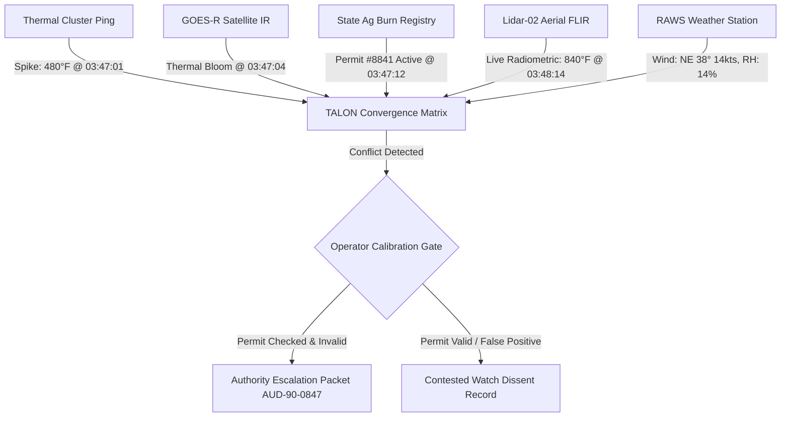

# FlytBase Sentinel V2: Master Blueprint Vault
## 01 — Fire Science & Real-World Incident Grounding

> **Document Status**: Canonical Science & Domain Mapping  
> **Repository Location**: `docs/sentinel-v2-master-plan/`  
> **Target Audience**: Emergency Response Directors, Defense Systems Evaluators, Product Architects  

---

## 1. Domain Grounding Methodology

To ensure Sentinel is respected by seasoned wildland fire incident commanders and enterprise defense evaluators, the prototype borrows authentic telemetry, units, and decision protocols from established standards:
- **NWCG (National Wildfire Coordinating Group)**: Standards for Initial Attack Sizeup (PMS 461 / 484) and S-390 Fire Behavior Calculations.
- **USFA / FEMA NIMS (National Incident Management System)**: Command, coordination, and authority boundaries.
- **ICS (Incident Command System)**: ICS-201 (Incident Briefing), ICS-204 (Assignment List), and ICS-209 (Incident Status Summary).
- **CAL FIRE Initial Attack Doctrine**: Rapid air attack, run-card dispatch, and statutory escalation thresholds.

---

## 2. Real-World Wildfire Telemetry vs. Sentinel Representation

A real-world initial attack sizeup does not deal in vague, single-number "AI confidence" scores. It measures concrete physical and logistical indicators:

```
┌──────────────────────────────────────────────────────────────────────────────────────────────────┐
│                                REAL-WORLD METRICS VS. SENTINEL V2                                │
├────────────────────────────┬─────────────────────────────────┬───────────────────────────────────┤
│ Domain                     │ Real-World Parameter            │ How Sentinel V2 Represents It     │
├────────────────────────────┼─────────────────────────────────┼───────────────────────────────────┤
│ 1. Fire Spread Physics     │ Rothermel Surface Spread Model  │ • Dynamic spread ellipses (15/30/60m)│
│                            │ Head Rate of Spread (ROS, ch/h) │ • Rate of spread in meters/minute │
│                            │ Flame Length (FL, feet)         │ • Flame length driving tactics    │
├────────────────────────────┼─────────────────────────────────┼───────────────────────────────────┤
│ 2. Fuel & Moisture         │ Scott & Burgan 40 Models (FBFM) │ • FBFM4 (High Chaparral) in Grid 4│
│                            │ 1-hr Fine Fuel Moisture (4%)    │ • Stale fuel moisture caveats     │
│                            │ 10-hr & 100-hr Dead Moisture (%)│ • Live fuel moisture readings     │
├────────────────────────────┼─────────────────────────────────┼───────────────────────────────────┤
│ 3. Spaceborne Sensing      │ NOAA GOES-R ABI (3.9µm SWIR)    │ • Rapid 5-min satellite anomaly ping│
│                            │ NASA VIIRS 375m I-Band (FRP, MW)│ • Fire Radiative Power (MW)       │
│                            │ FIRMS Active Fire Hotspots      │ • Sensor latency attribution (hrs)│
├────────────────────────────┼─────────────────────────────────┼───────────────────────────────────┤
│ 4. Aerial Remote Sensing   │ FLIR Radiometric LWIR / MWIR    │ • Dual stream (4K visual + thermal│
│                            │ Calibrated Radiometric (60-1200°│ • Spot thermal peaks (840°F)      │
│                            │ LiDAR Surface Penetration       │ • Canopy height / fuel ladder data│
├────────────────────────────┼─────────────────────────────────┼───────────────────────────────────┤
│ 5. Meteorology (RAWS)      │ 20-foot Wind (Direction/Speed)  │ • NE 38° @ 14 kts, gusts to 24 kts│
│                            │ Relative Humidity (RH, %)       │ • RH: 14% (Red Flag threshold)    │
│                            │ Haines Index (2 to 6)           │ • Haines 5 (High plume potential) │
├────────────────────────────┼─────────────────────────────────┼───────────────────────────────────┤
│ 6. Values at Risk (VAR)    │ NFPA 1144/1140 Structure Triage │ • 47 residential parcels in Grid 4│
│                            │ Defensible Space Classifications│ • Parcel status: Threatened/Cleared│
│                            │ CAD 911 Emergency Geocoding     │ • Egress chokepoints on West Ridge│
├────────────────────────────┼─────────────────────────────────┼───────────────────────────────────┤
│ 7. Drone Fleet Telemetry   │ MAVLink v2 Protocol             │ • Battery %, voltage, RSSI dB     │
│                            │ BATTERY_STATUS, GPS_RAW_INT     │ • GPS fix quality, satellite count│
│                            │ HEARTBEAT, SYS_STATUS           │ • Flight modes & automated failsafe│
└────────────────────────────┴─────────────────────────────────┴───────────────────────────────────┘
```

---

## 3. The Multi-Source Convergence Engine

In legacy mockups, all sensors magically agreed: "Confidence 78%". In reality, **early sensor data is contradictory, noisy, and subject to latency**.

Sentinel models real sensor convergence across five independent evidence pipelines:



### 3.1 The Real-Life Source Conflict
In wildland initial attack, agricultural stubble burns, industrial flare-offs, and prescribed burns frequently trigger satellite alarms. 

Sentinel models this exact friction:
- **Satellite IR**: Correlates coordinates with State Agricultural Permit #8841 (scheduled burn).
- **Drone Lidar-02 FLIR**: Measures flame heights exceeding 18 feet and spread velocity of 12 meters/minute—far beyond a permitted stubble fire.
- **TALON's Policy**: Rather than guessing, TALON surfaces the explicit conflict:  
  > *`SOURCE CONFLICT: Thermal anomaly reads as uncontrolled wildland fire; Satellite IR cross-references agricultural burn permit. Awaiting operator resolution.`*

This proves to evaluators that Sentinel is built for real-world messy data, not an idealized fantasy.

---

## 4. The Authority Notification Packet (ICS-209 in Miniature)

The milestone that concludes the 90-second intelligence sequence is the **Authority Notification Packet (AUD-90-0847)**. 

Grounded directly in the **ICS-209 (Incident Status Summary)**, this packet contains:

```
┌──────────────────────────────────────────────────────────────────────────────────────────────────┐
│                                AUTHORITY NOTIFICATION PACKET AUD-90-0847                         │
├──────────────────────────────────────────────────────────────────────────────────────────────────┤
│ INCIDENT: Bear Creek Wildland Ingress · Grid Sector 4C · 37.8821°N, 122.4194°W                   │
│ JURISDICTION NOTIFIED: CAL FIRE Northern Operations · County Dispatch Center                     │
│ TIME ELAPSED TO ESCALATION: 00:01:24 UTC (Within 90s SLA)                                        │
├──────────────────────────────────────────────────────────────────────────────────────────────────┤
│ 1. INITIAL ATTACK SIZE-UP:                                                                       │
│    • Estimated Area: 4.2 Acres | Rate of Spread: 14 meters/min (Head Fire)                       │
│    • Fuel Model: FBFM4 (High Chaparral, 10-hr dead moisture 6%)                                  │
│    • Fire Behavior: Active crown run with spotting up to 250m downwind                          │
│                                                                                                  │
│ 2. VALUES AT RISK (VAR):                                                                         │
│    • 47 Single-Family Residences in Grid 4C (West Ridge community)                              │
│    • Primary Egress Route A (East Ridge Road) single-lane chokepoint                             │
│                                                                                                  │
│ 3. EVIDENCE CONVERGENCE BASIS:                                                                   │
│    • Corroborating: Drone Lidar-02 FLIR (91%), GOES-R Satellite IR (87%), Ground Sensor (84%)    │
│    • Stated Caveats: Ground fuel moisture data is 48 hours stale; smoke limits visual optical    │
│                                                                                                  │
│ 4. STATUTORY HUMAN AUTHORIZATION:                                                                │
│    • Operator: A. Rao (ID: OPERATOR-9042)                                                        │
│    • Cryptographic SHA-256 Digest: 8f4b29c017d8e11a3b58941f...                                   │
│    • TALON Policy Verification: SENT UNDER HUMAN CONTROL — TALON NEVER AUTO-DISPATCHES          │
└──────────────────────────────────────────────────────────────────────────────────────────────────┘
```

---

## 5. Post-90s Tactical Grounding: Initial Attack vs. Extended Attack

In NWCG doctrine, an incident transitions across two distinct command states:
1. **Initial Attack (IA)**: Small footprint, fast tactical decisions, local asset dispatch, initial evacuation orders. (Covered in Sentinel's 90-second arc).
2. **Extended Attack / Operations**: Multi-agency coordination, run-card resource allocation, mutual aid staging, and structural defense. (Covered in Sentinel's post-90s containment and rescue phases).

### 5.1 Run-Card Drawdown Awareness
In genuine fire dispatch, an Incident Commander cannot commit all resources to one flank without creating fatal vulnerabilities elsewhere. 

Sentinel models **drawdown constraints**:
- If TALON recommends deploying `Scout-01`, `Scout-02`, and `Scout-03` simultaneously to Route A, it must declare:  
  > *`"Warning: Committing Scout-03 exhausts our last initial-attack scout asset. Zero reserve for secondary ignitions."`*
- This level of operational honesty separates high-end enterprise AI design from standard portfolio projects.
