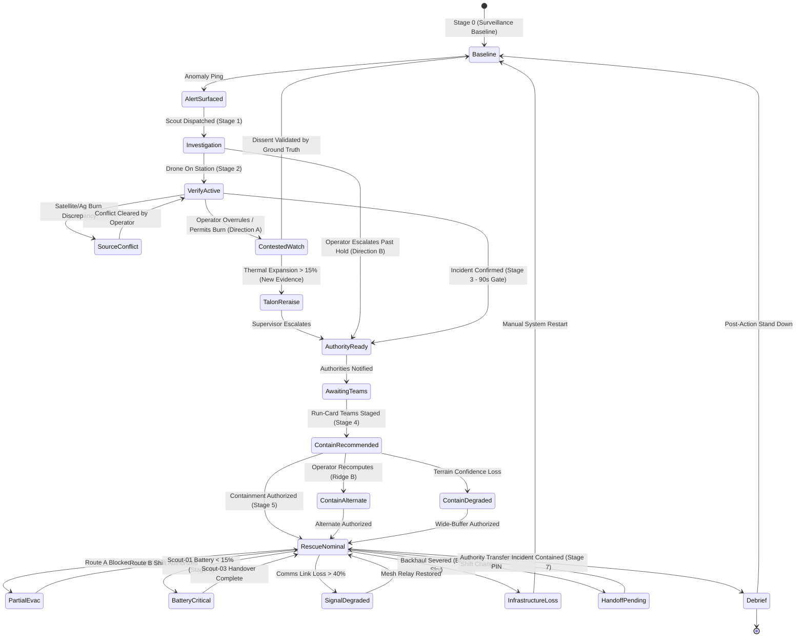

# FlytBase Sentinel V2: Master Blueprint Vault
## 03 — State Machine, Route Topology & Failure Catalog

> **Document Status**: Canonical State & Transition Standard  
> **Repository Location**: `docs/sentinel-v2-master-plan/`  
> **Target Audience**: State Machine Architects, Systems Engineers, UX Flow Designers  

---

## 1. The State Machine as Constitutional Law

In Sentinel V2, the state machine (`src/app/domain/stateMachine.ts`) is the single source of truth for both client and backend. 

### Core State Invariants:
1. **No Dead-End States**: Every normal and fault-injected state possesses valid, documented recovery or exit edges.
2. **Strict Gate Enforcement**: High-consequence actions (`confirm-incident`, `notify-authorities`, `authorize-containment`, `emergency-evacuate`) cannot be triggered without satisfying explicit human authorization gates.
3. **No Silent Dissent**: Any operator overrule of a TALON recommendation must capture an immutable reason string and enter a dedicated contested tracking state.
4. **Anti-Nagging Boundary**: TALON is structurally prohibited from repeating a rejected recommendation unless new corroborating sensor evidence crosses a raised confidence threshold.

---

## 2. Complete 8-Stage Operational Lifecycle



---

## 3. Beat-by-Beat 90-Second Intelligence Arc

The first 90 seconds are choreographed to maintain urgency without causing panic:

```
┌──────────────────────────────────────────────────────────────────────────────────────────────────┐
│                                 THE 90-SECOND INITIAL ATTACK ARC                                 │
├───────┬──────────────────────┬───────────────────────────────┬───────────────────────────────────┤
│ Clock │ State / Route        │ Operator Question Answered    │ TALON Behavioral Posture          │
├───────┼──────────────────────┼───────────────────────────────┼───────────────────────────────────┤
│ T+00s │ `baseline`           │ "What is nominal?"            │ Watching: 3 active sources, 3     │
│       │                      │                               │ aligning. Ambient patrol vectors. │
├───────┼──────────────────────┼───────────────────────────────┼───────────────────────────────────┤
│ T+12s │ `alert-command`      │ "Why was I interrupted?"      │ Listening: 3-source convergence   │
│       │                      │                               │ (thermal spike + wind vector).    │
├───────┼──────────────────────┼───────────────────────────────┼───────────────────────────────────┤
│ T+20s │ `investigation`      │ "What is the scout doing?"    │ Solving: Scout Lidar-02 en route  │
│       │                      │                               │ (ETA: 14s). Evidence prefilling.  │
├───────┼──────────────────────┼───────────────────────────────┼───────────────────────────────────┤
│ T+45s │ `verify-active`      │ "Is this fire real & urgent?" │ Solving: Live dual-stream active. │
│       │                      │                               │ Burn permit conflict evaluated.   │
├───────┼──────────────────────┼───────────────────────────────┼───────────────────────────────────┤
│ T+75s │ `authority-ready`    │ "Do I send this packet?"      │ Gated: Cryptographic packet ready.│
│       │                      │                               │ "I prepare; you authorize."       │
├───────┼──────────────────────┼───────────────────────────────┼───────────────────────────────────┤
│ T+88s │ `contain-recommended`│ "What is our tactical plan?"  │ Staging: Authorities notified.    │
│       │                      │                               │ Tactical staging begins.          │
└───────┴──────────────────────┴───────────────────────────────┴───────────────────────────────────┘
```

---

## 4. The Disagreement Arc (Structural Dissent)

Sentinel’s signature design innovation is how it handles human-AI disagreement in **both directions**:

### 4.1 Direction A: Operator Refuses TALON’s Escalation
- **Context**: At `verify-active`, TALON recommends escalation based on thermal heat bloom. The operator believes it is a permitted agricultural burn.
- **Action**: Operator clicks `Decline Escalation`.
- **System Behavior**:
  1. The Dissent Modal opens; operator enters justification: *"Permitted vineyard burn confirmed via local VHF radio."*
  2. Transition moves to `monitoring-contested`.
  3. TALON enters **Reduced-Weight Watch**: tracking continues silently in the background.
  4. The bar to re-raise is elevated: TALON cannot interrupt again unless fire front expands by >15% or crosses a buffer line.
  5. If new evidence arrives, TALON triggers `talon-reraise`, presenting the delta to the duty supervisor.

### 4.2 Direction B: Operator Escalates Past TALON’s Hold
- **Context**: During `investigation-pending`, the scout is still 10 seconds away, but the operator visually spots a smoke plume out the window.
- **Action**: Operator clicks `Confirm Incident Early`.
- **System Behavior**:
  1. TALON complies immediately without obstruction.
  2. It attaches an immutable note to the packet:  
     `escalationBasis: "operator-initiated (pre-convergence)"`
  3. TALON’s dissent rides along inside the audit ledger: *"TALON advised holding 10s for Lidar-02 optical confirmation; operator exercised executive authority to escalate."*

---

## 5. Comprehensive Failure & Degradation Catalog

Every critical failure mode in Sentinel has a distinct visual surface and a verified exit edge:

```
┌──────────────────────────────────────────────────────────────────────────────────────────────────┐
│                                   FAILURE CATALOG & RECOVERY EXITS                               │
├──────────────────────────┬─────────────────────────────┬─────────────────────────────────────────┤
│ Failure State            │ Root Cause / Failure Mode   │ Verified Recovery Exit                  │
├──────────────────────────┼─────────────────────────────┼─────────────────────────────────────────┤
│ `satellite-feed-loss`    │ GOES-R downlink timeout     │ Deploy second drone Scout-03 for aerial │
│                          │ during initial sizeup       │ cross-corroboration (`deploy-survey`)   │
├──────────────────────────┼─────────────────────────────┼─────────────────────────────────────────┤
│ `network-degraded`       │ 340ms cellular pipe latency │ Shed secondary telemetry; route via     │
│                          │ and 48% packet drop         │ local mesh drone (`relay-field-intel`)  │
├──────────────────────────┼─────────────────────────────┼─────────────────────────────────────────┤
│ `rescue-battery-critical`│ Scout-01 battery drops to   │ Supervised automated handover: Scout-03 │
│                          │ 14% while guiding evacuees  │ intercepts waypoint (`acknowledge-handoff`)│
├──────────────────────────┼─────────────────────────────┼─────────────────────────────────────────┤
│ `rescue-signal-degraded` │ Smoke cloud attenuates RF to│ Deploy mesh repeater Relay-03 overhead  │
│                          │ ground crew Strike Team A   │ (`deploy-backup`)                       │
├──────────────────────────┼─────────────────────────────┼─────────────────────────────────────────┤
│ `infrastructure-total-loss`│ Simultaneous power cut and│ Full-screen red takeover: fallback to   │
│                          │ satellite backhaul severance│ VHF Radio 154.280 MHz (`system.restart`) │
└──────────────────────────┴─────────────────────────────┴─────────────────────────────────────────┘
```

---

## 6. The 4 Newly Promoted Micro-States

To address the gaps identified in the architecture review, four intermediate states are promoted to full first-class members of the state machine:

1. **`verify-source-conflict`**:
   - Promotes the burn-permit calibrator from an embedded checkbox into an addressable state.
   - Dedicated TALON pitch: *"Two primary sources disagree: Thermal reads 840°F crown run; Satellite cross-references Permit #8841. Awaiting operator resolution."*
2. **`contain-awaiting-teams`**:
   - Gated state distinguishing "containment plan not computed" from "ground crews not yet notified".
   - Prevents operators from authorizing containment before ground units are staged.
3. **`rescue-partial-evac`**:
   - Models real-world evacuation stalls when smoke blocks primary corridors.
   - TALON dynamically surfaces Route B shift as a priority exception.
4. **`handoff-pending`**:
   - Transforms shift change from an activity log entry into a structured briefing moment.
   - Outgoing operator reviews audit receipts; incoming operator enters PIN (8842) to assume command.
